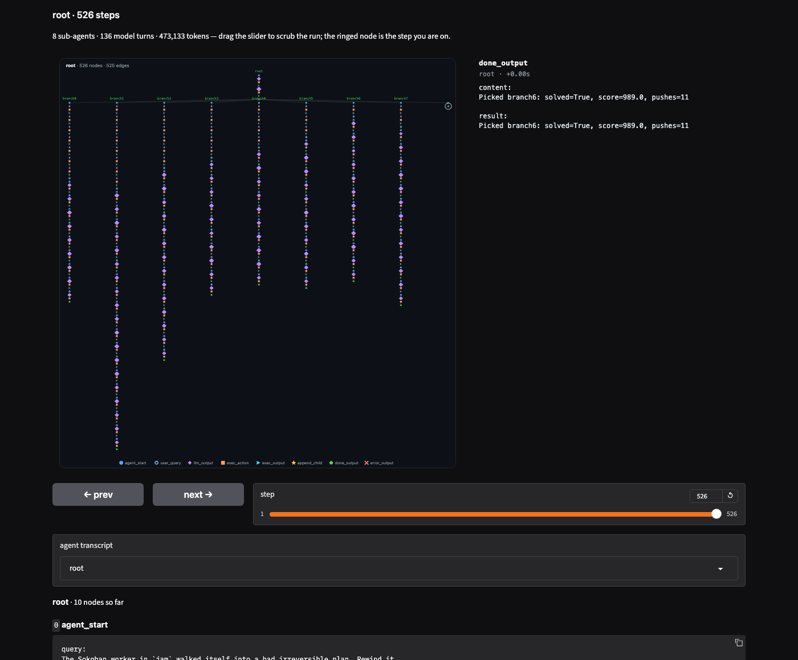

# rlmflow

<p align="center">
  <a href="https://pypi.org/project/rlmflow/"></a>
  <a href="https://github.com/shyamsn97/rlmflow/pkgs/container/rlmflow"></a>
</p>

Read the blog post: [rlmflow](https://shyamsn97.github.io/blog/rlmflow/).

**rlmflow** is a Python library for building **recursive agents** — agents that spawn other agents — as live execution graphs. Every query, action, observation, child agent, and result is a typed node you can inspect, step through, save, fork, and append to mid-run.

It gives an LLM a stateful Python REPL and a graph-native way to spawn agents with fresh context.

<p align="center">
  
</p>
<p align="center"><em>Recursive execution above; durable, inspectable state underneath.</em></p>

The release has three complementary flagship demonstrations: **Shepherd** recovers a failed execution graph, **Needle** proves recursive parallel decomposition, and **Boids** applies the same model to building a complete browser application. Everything else is an API tour or supporting benchmark evidence.

## Flagship examples

### Shepherd: recover the graph, not just the answer

The example first writes a reproducible failed worker trace by scripting eight myopic Sokoban pushes. GPT-5 then reads that execution, previews earlier graph states, and proposes eight differently instructed GPT-5-mini recoveries across several rewind depths. The host forks and runs them as the shepherd's child agents, then selects the highest-scoring result. Planning and recovery play use live model calls; the fixed jam makes runs comparable, and the local deterministic game makes graph replay exact.

<p align="center">
  
</p>
<p align="center"><em>One failed run becomes eight recoverable branches inside the same retained graph.</em></p>

<p align="center">
  
</p>
<p align="center"><em>Recorded board replay: deliberate jam → rewind → selected live-model recovery.</em></p>

```bash
uv run --locked --python 3.12 --extra openai --extra image \
  python examples/shepherd/shepherd.py \
  --model gpt-5 --fast-model gpt-5-mini --branches 8 --time-budget 1800
```

In the checked-in run, six of eight recoveries solved; Shepherd selected `branch2`, which rewound seven pushes and solved in 11 total pushes. The run is saved under `examples/_runs/shepherd/`; `make showcase-shepherd-assets` reproduces the checked-in SVG and GIF assets. See the [example instructions](examples/shepherd/) and [worked walkthrough](docs/shepherd.md).

### Needle: decompose a million-line value

The root receives one million lines as the direct `haystack` argument, partitions the value in its REPL, delegates chunks to GPT-5-nano workers with fresh contexts, and checks their combined answer against the generated secret.

<p align="center">
  
</p>
<p align="center"><em>Parallel graph replay: same-level nodes across the 13 worker branches light together. The recorded run reached 10-way wall-clock concurrency.</em></p>

```bash
uv run --locked --python 3.12 --extra openai \
  python examples/needle/haystack.py \
  --num-lines 1000000 --model gpt-5-mini --fast-model gpt-5-nano
```

The checked-in run generated `5335239` at line 466,831 and returned the same value in 3m 26s using 13 child workers, with peak concurrency of 10. Its saved graph at `examples/_runs/needle-haystack/` renders directly to a steppable HTML trace, static graph, and level-synchronized parallel animation; `make showcase-needle-assets` reproduces the checked-in assets. See the [Needle example](examples/needle/).

### Boids: let the agent design a browser simulation

A root coding agent turns product-level constraints into a dependency-free browser simulation: 2,000 boids, four species, spatially indexed neighbor search, steering rules, rendering, and a full-viewport shell. The prompt names no files, module boundaries, or delegation plan; the agent chooses the architecture and execution graph before verifying the result.

<p align="center">
  
</p>
<p align="center"><em>A live browser application produced from one product-level specification. <a href="https://raw.githubusercontent.com/shyamsn97/rlmflow/main/docs/static/boids/simulation.mp4">MP4 recording</a>.</em></p>

<p align="center">
  
</p>
<p align="center"><em>Graph replay of the model-chosen implementation: five independent file owners run concurrently, then the root launches one focused repair.</em></p>

```bash
uv run --locked --python 3.12 --extra openai --extra image \
  python examples/coding/boids/boids.py \
  --runner rlmflow --model gpt-5 --fast-model gpt-5-mini --force
```

In the recorded run, the root chose a five-file app and launched five GPT-5-mini file owners concurrently, followed by one focused integration repair. It completed in 4m 42s using 84,650 input-plus-output tokens. Local-reference checks, JavaScript syntax checks, a console-error-aware headless-browser load, and a nonblank-frame check all passed. The run writes the application and retained graph under `examples/_runs/coding/boids-rlmflow/`; `make showcase-boids-assets` reproduces the checked-in poster, continuous browser GIF/MP4, and graph animation. See the [run record](examples/coding/boids/recorded-run.json) and [coding example instructions](examples/coding/).

### Benchmarks: long context and visual interaction

The evaluation harness compares the original `official-rlm` runtime with rlmflow at depths 0, 1, and 2 under one contract. Its default long-context benchmark is a fixed OOLONG TREC-coarse 128K slice: two questions for pilot runs and 25 for full runs. MazeBench is the official interactive benchmark, while a 16-task frozen swarm-fanout matrix compares pinned PrimeAgent, Official RLM, JAZ, and rlmflow through normalized delegation evidence. Paid rows run in Docker by default, with Modal as an optional remote executor. See [Evaluation suites](docs/benchmarks.md).

| Suite          | What it tests                                                            | Frozen workload                                                                           | Compared runners                                  |
| -------------- | ------------------------------------------------------------------------ | ----------------------------------------------------------------------------------------- | ------------------------------------------------- |
| `smoke`        | End-to-end infrastructure                                                | Deterministic synthetic needle                                                            | Official RLM, rlmflow depths 0–2                  |
| `delegation`   | Complete fan-out without fabricated, duplicate, or dropped work          | 16 tasks; 4–16 shards across JSON, CSV, JSONL, TSV, logs, Markdown, nested JSON, and text | PrimeAgent, Official RLM, JAZ, rlmflow depths 1–2 |
| `long-context` | Extraction and reasoning over large inputs                               | OOLONG TREC-coarse 128K; 25-question full split                                           | Official RLM, rlmflow depths 0–2                  |
| `interactive`  | Search, branching, actions, candidate submission, and explicit selection | MiniMaze, Sudoku Search, and MazeBench                                                    | Official RLM, rlmflow depths 0–2                  |

The comparison contract is intentionally auditable:

- every runner receives the same benchmark-owned task and canonical observation bytes;
- task, observation, and framework-specific guidance hashes are recorded separately;
- hidden answers and simulator state stay inside the environment;
- every row records score, errors, token use, wall time, turns, agents, nodes, and native environment metrics;
- interactive runs retain action, fork, candidate, and selection evidence instead of grading only the final prose.

A saved GPT-5 OOLONG-Pairs 32K pilot provides a small two-runner reference:

| Runner          | Mean pair F1 | Errors | Avg. tokens |
| --------------- | -----------: | -----: | ----------: |
| `official-rlm`  |        0.336 |  11/20 |      32,994 |
| `rlmflow-local` |        0.508 |   6/20 |      19,549 |

These are descriptive results from one 20-example-per-runner pilot recorded on 2026-09-02, including errored rows in the mean. They are not a release gate, significance test, or general superiority claim. The exact aggregate and provenance are checked in at [`benchmarks/results/oolong-pairs-32k-gpt5-pilot.json`](benchmarks/results/oolong-pairs-32k-gpt5-pilot.json).

## Recursive agents as graphs

Recursive agents let a model split work across fresh sub-agents, each with its own context, tools, and execution history. Those sub-agents can delegate again, so one root task can quickly become a tree of parallel work.

For example, the root agent can split a haystack into chunks. Every launch returns a future-like handle immediately:

```python
handles = [
    launch_subagent(task="scan first third", chunk=chunk_0),
    launch_subagent(task="scan middle third", chunk=chunk_1),
    launch_subagent(task="scan final third", chunk=chunk_2),
]
results = await asyncio.gather(*handles)
submit(extract_answer(results))
```

When the caller knows an input's structure, it can pass that knowledge without copying the value into the child's prompt:

```python
from rlmflow import Input

child = launch_subagent(
    task="Analyze these records.",
    rows=Input(rows, description="List of {user_id, label, text} records."),
)
```

The child receives the raw value as `rows`; its argument manifest includes the description. `Input(...)` also works on root arguments.

The host can run every delegated child through Claude Code without changing
that agent-facing API:

```python
from rlmflow import AgentConfig, ClaudeCodeBackend, Flow

flow = Flow(
    llm,
    backends={"claude-code": ClaudeCodeBackend(permission_mode="acceptEdits")},
)
root = g.create_agent(task, config=AgentConfig(max_depth=1, child_config={"backend": "claude-code"}))
```

The root remains an rlmflow agent; its `launch_subagent(...)` calls become
Claude Code jobs in the Flow working directory. Native rlmflow children remain
the default when `child_config` names no backend. Any agent, including a
top-level one, can also name a backend directly with
`AgentConfig(backend="claude-code")`. See the runnable
[`claude_code_delegation.py`](examples/providers/claude_code_delegation.py)
example for parallel structured children editing one shared demo workspace.

Then `chunk_2` can recursively delegate again:

```python
hits = find_candidate_windows(chunk)
handles = [
    launch_subagent(task="inspect window A", window=hits[0]),
    launch_subagent(task="inspect window B", window=hits[1]),
]
results = await asyncio.gather(*handles)
submit(select_candidate(results))
```

That code creates an agent graph:

```text
root  "Find the code in the haystack"
├── child0      "scan first third"   -> "not found"
├── child1      "scan middle third"  -> "decoy, no code"
└── child2      "scan final third"   -> "candidate code 84721"
    ├── child0  "inspect window A" -> "decoy"
    └── child1  "inspect window B" -> "code 84721"
```

That parent API is useful: children return simple values the parent can compose. The problem is when those return values are the only surviving record of the work:

```text
results == ["not found", "decoy, no code", "candidate code 84721"]
```

If `chunk_2` launched `candidate_a` and `candidate_b` internally, the parent can still receive `"candidate code 84721"` as its normal result. But for debugging, evaluation, supervision, or reuse, you also want the execution state that produced it: which agents ran, what they saw, what failed, and where you could intervene.

**rlmflow** keeps that structure alive. Every recursive call is a child agent inside one typed `Node` tree:

<p align="center">
  
</p>

The graph is the run itself:

```python
from rlmflow import Flow, Graph, Node, reads

g = Graph()
root = g.create_agent(query)          # only writes to the graph; nothing runs yet

flow = Flow(client)
async for item in flow.run_streaming(g):
    if isinstance(item, Node):
        print(reads.path(g, g.node(item.agent_id)), item.type)
```

`run_streaming(g)` appends to the graph and yields each node and edge as it lands. The graph *is* the durable state: you can edit it freely with `rlmflow.ops` (spawn, append, send, fork, attach) with no `Flow` around, save it, load it elsewhere, and hand it to any `Flow`. The flow creates each agent's REPL the first time that agent steps, replaying its recorded code if it already has history.

Start with the runnable [graph-manipulation tour](examples/graph/) for append,
fork, subtree attachment, persistence, and traversal. See
[`docs/internals.md`](docs/internals.md), [`docs/node_model.md`](docs/node_model.md),
and [`docs/control.md`](docs/control.md) for the full engine and graph API.

## Install

```
pip install rlmflow               # core
pip install rlmflow[openai]       # + OpenAI client
pip install rlmflow[anthropic]    # + Anthropic client
pip install rlmflow[tinker]       # + Tinker inference client
pip install rlmflow[textcraft]    # + Gymnasium TextCraft environment example
pip install rlmflow[rao]          # + TextCraft and Tinker RAO training
pip install rlmflow[dspy]         # + DSPy adapter
pip install rlmflow[modal]        # + Modal runtime
pip install rlmflow[tui]          # + full-screen TUI
pip install rlmflow[viewer]       # + browser viewer
pip install rlmflow[image]        # + PNG / GIF export
pip install rlmflow[all]          # all of the above
```

From source:

```
git clone https://github.com/shyamsn97/rlmflow && cd rlmflow
pip install -e .
```

For local development, `make install` runs cleanup and `ruff check .`, then installs the package.

> **Security warning — `LocalRuntime` is not a sandbox.** Agent code runs as full Python in a separate worker process, but with the same filesystem, network, environment, and subprocess privileges as the host. LLM-generated code can be wrong or malicious (prompt injection, model errors, supply-chain risk). **Use `LocalRuntime` only for code you would run yourself.** For untrusted agents or anything exposed to the internet, use [`DockerRuntime`](docs/runtimes.md) or a remote sandbox ([`ModalRuntime`](docs/runtimes.md)). See [`docs/security.md`](docs/security.md). **Use at your own risk.**

## Quick start

This example builds a simple coding agent with file tools in a local working directory. See [`examples/coding/agent.py`](./examples/coding/agent.py) for the full interactive version.

```python
from pathlib import Path

from rlmflow.llm import OpenAIClient
from rlmflow import FILE_TOOLS, AgentConfig, Flow, Graph, LocalRuntime, Node, reads

workdir = Path("examples/_runs/quickstart")

flow = Flow(
    OpenAIClient(model="gpt-5"),
    runtime=LocalRuntime(working_directory=workdir),
    tools=[FILE_TOOLS],
    llm_clients={"fast": OpenAIClient(model="gpt-5-mini")},
)

g = Graph()
query = "Build a Python text-based adventure game with combat and inventory."
root = g.create_agent(query, config=AgentConfig(max_depth=2, max_iters=20))

async for item in flow.run_streaming(g):
    if isinstance(item, Node):
        print(reads.path(g, g.node(item.agent_id)), item.type)

print(reads.result(g, root))
g.save(workdir / "graph")
```

Delegated children fan out as ordinary asyncio tasks that step alongside their parent. See [`examples/control/delegation/step_until.py`](./examples/control/delegation/step_until.py) for a deterministic demo of `Flow.run_streaming(..., until=...)` boundaries while child work runs concurrently.

A saved run is a directory holding the graph's item log. Reopen it later with `Graph.load(path)` and keep running it.

## Command line

`rlmflow tui` is the coding agent above, without writing any of that. It edits `--workdir` (`.` by default), checkpoints to `<workdir>/graph`, and opens the dashboard — install it with `pip install "rlmflow[tui]"`.

```bash
pip install "rlmflow[tui]"

rlmflow tui                                   # the dashboard, waiting for a query
rlmflow tui --query "add a test for parse_args"
rlmflow tui --workdir ./proj --model gpt-5 --docker-image rlmflow:local
rlmflow tui --resume ./proj/graph             # pick a saved run back up
rlmflow tui --agent mypkg.agents:build        # your own Flow instead of the coding one

rlmflow run print "fix the failing test"      # no dashboard: stream it, print the answer
```

`--model` / `--fast-model` pick the clients (`claude*` → Anthropic, else OpenAI), `--reasoning-effort` reaches OpenAI reasoning models, and `--tools {files,none}` chooses whether the agent gets `FILE_TOOLS`. Anything the flags cannot say — custom prompts, tools, runtimes — stays in Python: point `--agent` at a `module:factory` that returns a `Flow`.

```python
# mypkg/agents.py
from rlmflow import FILE_TOOLS, AgentConfig, Flow, LocalRuntime
from rlmflow.llm import client_for

def build() -> Flow:
    return Flow(
        client_for("gpt-5", reasoning_effort="low"),
        runtime=LocalRuntime(working_directory="."),
        tools=[FILE_TOOLS],
    root_config=AgentConfig(max_depth=2, max_iters=40),
    )
```

Settings resolve flags first, then `RLMFLOW_*`, then `./rlmflow.toml`, then `~/.config/rlmflow/config.toml`:

```bash
rlmflow config show    # every setting, its value, which source won
rlmflow config path    # the files that are read
rlmflow config init    # write a starter rlmflow.toml
```

```toml
# rlmflow.toml
[run]
model = "gpt-5"
fast_model = "gpt-5-mini"
reasoning_effort = "low"
max_iters = 30
```

A finished run is what `rlmflow view` and `rlmflow render` read — the tree and timeline, or a figure / stepper / GIF / browser viewer. See [Visualization](#visualization) below, and [`docs/cli.md`](docs/cli.md) for the full flag list. `python -m rlmflow …` works the same; `rlmflow --help` lists every command.

## Drop-in `LLMClient`

`FlowLLM` wraps a `Flow` in the `LLMClient` `chat(messages)` interface, so a full recursive agent run is a drop-in replacement for any raw LLM.

```python
import rlmflow
from rlmflow.llm import LLMClient, OpenAIClient
from rlmflow.flow import FlowLLM

def ask(llm: LLMClient, q: str) -> str:
    return llm.chat([{"role": "user", "content": q}])

ask(OpenAIClient(model="gpt-4o-mini"), "2+2?")                      # one LLM call
ask(FlowLLM(rlmflow.Flow(OpenAIClient(model="gpt-4o-mini"))), "2+2?")  # full agent loop
```

Nest agents by passing one `FlowLLM(inner_flow)` as another flow's `llm`. See [`examples/drop_in_llm.py`](examples/drop_in_llm.py).

## Stream and inspect

`Flow` gives you three ways to drive the same durable graph:

- `flow.run("task")` — run a new agent to completion and return its result; `flow.run(g)` runs a graph and returns it.
- `await flow.arun(...)` — the same, async.
- `async for item in flow.run_streaming(g, until=...)` — stream landed nodes and edges to a boundary.

```python
g = Graph()
root = g.create_agent(query)
seen = 0

def two_steps(item, _g):
    global seen
    seen += isinstance(item, Node)
    return seen == 2

async for item in flow.run_streaming(g, until=two_steps):
    pass
print(reads.frontier(g, root).type)   # ...inspect...
async for item in flow.run_streaming(g, until="done"):
    pass                              # ...then run to completion
print(reads.result(g, root))
```

Every assistant turn emits exactly one REPL action:

```text
LLMOutput -> ExecAction -> ExecOutput          (normal continuation)
                        -> DoneOutput           (submitted result)
                        -> ErrorOutput         (invalid response, code error, or dead REPL)
```

A turn that delegates hangs its children off the `ExecAction` that launched them, and lands one `ExecOutput` when the block finishes — so a parent's transcript stays a single chain whether or not it spawned anyone.

The graph is queryable in plain Python:

```python
root.frontier                           # current Node for this agent
root.transcript()                       # this agent's typed history
root.sub_agents                         # the agents it launched
root.leaves()                           # the frontier of every agent in the tree
list(root.walk())                       # every Node, preorder
root.result()                           # root DoneOutput result
root.usage                              # O(1) whole-run usage
root.stats                              # immutable counts and usage snapshot
root.frontier.metadata                  # open JSON telemetry for consumers/tools

from rlmflow import persistence
persistence.to_document(root)           # flat, unversioned JSON document
```

Every node's `metadata` is durable through save/load/fork. Built-in telemetry
records LLM usage and timing; proxy tools record call receipts; custom host
tools can call `record_metadata(...)`; benchmark layers can attach rewards and
verdicts without changing the core node schema.

## Inject controller Nodes

Because the Node tree is the control surface, an external controller can append to any agent's frontier — as its node lands, or between streaming calls — and let the run continue. This is useful for human feedback, budget nudges, and forced finalization without losing traceability:

```python
from rlmflow import ExecOutput, ops

# nudge a worker the moment it comes up for air, then let the run continue
async for item in flow.run_streaming(g):
    if isinstance(item, ExecOutput) and item.agent_id != root.id:
        ops.send(g, g.node(item.agent_id), "Answer with the best evidence.")
```

Injected nodes become ordinary graph nodes with the same shape as organic ones. An append lands on an agent's frontier or it raises, so history stays append-only, and forking is how you change what an agent already did. See [`docs/injections.md`](docs/injections.md) and [`examples/control/injection/`](examples/control/injection/).

## Save, load, and fork

The graph is the durable run:

```python
g = Graph()
root = g.create_agent(query)
flow.run(g)
run_dir = g.save("runs/shepherd")

latest = Graph.load(run_dir)
```

Fork an independent branch from any node and continue it with a `Flow`:

```python
branch = ops.fork(latest, node, name="repair")   # a new agent sharing history up to node
flow.run(latest)
latest.save("runs/shepherd_repair")
```

A `Flow` that has not run a tree — loaded, forked, or from another process — rebuilds each unfinished agent's REPL from its recorded code before stepping it. `Flow(restore="lazy")` defers that reconstruction until the agent first needs its REPL. Restorable tools reuse saved results, so child launches and `llm_query` calls do not repeat external work. See [`examples/showcase.py`](examples/showcase.py), [`docs/control.md`](docs/control.md), and [`docs/injections.md`](docs/injections.md).

## Visualization

Because the run *is* a typed graph, every view is a render of that graph. They all live in `rlmflow.view`, re-exported from `rlmflow`, and all work the same on a live tree, a loaded one, or a fork.

### Live terminal tree

`render_tree(root)` is the whole agent tree as ASCII — reprint it each tick to watch a run unfold:

```python
from rlmflow import render_tree

async for node in flow.run_streaming(root):
    print("\033[2J\033[H" + render_tree(root))   # clear + redraw
```

```text
The Sokoban worker in `jam` walked itself into a bad irreversible plan.
└── root: children running 1/2 (2 turns)
    ├── root.branch0: done stuck (16 turns)
    └── root.branch1: planning (5 turns)
```

`LiveTreeRenderer` and `LiveGraphTree` package that as stream consumers if you would rather hand them nodes as they land.

### Full-screen TUI

```bash
pip install "rlmflow[tui]"
rlmflow tui --query "add a test for parse_args"
```

Chat on the left with a tab per agent; clickable tree on the right. Send (or Ctrl+S) submits query and context. Ctrl+R continues a paused run, Ctrl+T steps once.

<p align="center">
  
</p>

Or hand `FlowTUI` a flow yourself:

```python
from rlmflow.consumers import FlowTUI, GraphCheckpointer

ui = FlowTUI(sink=GraphCheckpointer("runs/coding/graph"))
ui.init(flow)
ui.run()                       # ui.run(query="fix the tests") starts one immediately
```

It is a stream consumer like the rest, so the checkpointer sees every node, and feeding it from your own `async for node in flow.run_streaming(...)` loop still works.

### Browser viewer

`open_viewer(source)` puts a step slider over the figure, an agent picker beside it, and that agent's transcript underneath — all as of the step you are on:

```python
from rlmflow import open_viewer

# the shepherd example's own run, once you have run it
open_viewer("examples/_runs/shepherd/shepherd")   # needs: pip install rlmflow[viewer]
```

<p align="center">
  
</p>

### Figures, steppers, and frames

The same graph, without a server:

```python
from rlmflow import graph_svg, render_steps, replay, save_html, save_svg, steps, timeline

for step in steps(root):              # the run in order, with content
    print(step.index, step.title, step.summary)

for snap in replay(root):             # the tree as it stood at each step
    print(render_tree(snap))

save_svg(root, "graph.svg")           # the figure
save_html(root, "run.html")           # a single-file stepper, arrow keys and all
```

The stepper is one self-contained page — the graph with the node you are on ringed, everything after it faded back, its content beside it. It embeds the figure once and reveals it a node at a time, so a 500-node run is a few hundred KB you can mail, not a flipbook of duplicated drawings.

Or from the shell, on any saved run — here the one the shepherd example wrote:

```bash
RUN=examples/_runs/shepherd/shepherd
rlmflow view show $RUN               # the agent tree, then the timeline
rlmflow view show $RUN --step 12     # one step, with its content
rlmflow view show $RUN --frames-only # every step as an ASCII tree
rlmflow render svg $RUN g.svg        # the figure
rlmflow render html $RUN run.html    # steppable single file
rlmflow render browser $RUN          # the viewer above
rlmflow render gif $RUN run.gif      # animated (needs [image])
rlmflow render frames $RUN out/      # a PNG per step (needs [image])
```

`python -m rlmflow view show …` works the same. Everything here needs nothing beyond the standard library except the two that say otherwise: the viewer wants `rlmflow[viewer]`, and PNG/GIF export wants `rlmflow[image]`. See [`docs/observability.md`](docs/observability.md).

## How Shepherd uses the graph

Because a run is a durable graph rather than a one-way transcript, a second agent can be programmed against it. [Shepherd](https://arxiv.org/abs/2605.10913) (Yu et al., 2026) motivates this experimental example, but rlmflow does not implement Shepherd's reversible environment model. It reads an earlier graph node, forks from it, and re-instructs the copy; external state is rebuilt by the example.

[`examples/shepherd/`](examples/shepherd/) does that to a concrete failed trace. A fixed script records a worker shoving one box past saving; a larger model reads the trace, reverts to eight different earlier pushes, and gives each live worker fork its own plan to try in parallel. The forks are its own children, so the search is one agent tree. A runtime-bound current-frontier renderer adds each worker's live board without putting runtime state on graph nodes or closing over the `Flow`.

[`docs/shepherd.md`](docs/shepherd.md) is the full walkthrough: the tools the meta-agent gets, the plans it wrote, and what each branch did.

## DSPy Adapter

`DSPyFlow` lets DSPy use a `Flow` agent anywhere it expects a language model — every DSPy "LM call" becomes a full recursive agent run:

```python
import dspy
import rlmflow
from rlmflow import AgentConfig
from rlmflow.llm import OpenAIClient
from rlmflow.flow import FlowLLM
from rlmflow.integrations.dspy import DSPyFlow

flow = rlmflow.Flow(
    OpenAIClient(model="gpt-4o-mini"),
    root_config=AgentConfig(max_depth=1, max_iters=5),
)

dspy.configure(lm=DSPyFlow(FlowLLM(flow), model="rlmflow/gpt-4o-mini"))
qa = dspy.ChainOfThought("question -> answer")
print(qa(question="What is 17 * 23?").answer)
```

Install it with `pip install rlmflow[openai,dspy]`. See [`examples/providers/dspy_drop_in.py`](examples/providers/dspy_drop_in.py) for the runnable version.

## Customizable skills

Give agents reusable know-how without baking it into the core prompt. Put project conventions, domain playbooks, child-agent contracts, benchmark heuristics, or lessons from previous runs in `SKILL.md` files, then load the right ones for each root or child agent.

See [`docs/skills.md`](docs/skills.md) for examples of always-on skills, query-selected skills, child-only skills, and run-memory skills. [`examples/skills.py`](examples/skills.py) is the runnable minimal version.

## Examples

Shepherd, Needle, and Boids are the release showcases. The smaller scripts, API tours, provider integrations, sandbox examples, and offline smoke runner live in the [`examples/` guide](examples/README.md).

## Benchmarks (research beta)

Evaluation is organized around four environment collections. The full report is not just a leaderboard: it preserves the evidence needed to tell whether an agent actually delegated, explored, forked, selected, or merely guessed.

```bash
make -f benchmarks/Makefile smoke
make -f benchmarks/Makefile image
make -f benchmarks/Makefile delegation
make -f benchmarks/Makefile long-context
make -f benchmarks/Makefile interactive
python benchmarks/run_benchmark.py --list
```

| Suite          | Question                                                             |
| -------------- | -------------------------------------------------------------------- |
| `smoke`        | Can the pipeline recover a needle from a synthetic haystack?         |
| `delegation`   | Can fan-out avoid fabricated, duplicate, or dropped work?            |
| `long-context` | How do harnesses manage paper-aligned OOLONG tasks?                  |
| `interactive`  | How do harnesses search, branch, and act in persistent environments? |

Use `--split pilot` for bring-up and `--split full` for complete frozen manifests. See [docs/benchmarks.md](docs/benchmarks.md) for runner matrices and result artifacts. The repository does not claim comparative quality, cost, or latency beyond checked-in or reproducibly generated run evidence.

## Docs

The top-level docs are short, user-facing guides. The deep dive lives in [`docs/internals.md`](docs/internals.md). Research notes live under [`docs/research/`](docs/research/).

- [**Upgrading to 0.7**](UPGRADING.md): breaking API and persistence changes.
- [**Internals**](docs/internals.md): Node structure, Flow transitions, the task queue and pools, Runtime identity, replay, forks, and persistence.
- [**Structured outputs**](docs/structured_outputs.md): output codecs, chat, Instructor, Jev, and explicit retry/fallback composition.
- [Blog post](https://shyamsn97.github.io/blog/rlmflow/): long-form pitch — recursive agents, why graphs beat flat traces, and walkthroughs.
- [Positioning](docs/positioning.md): when to use rlmflow vs rlm-minimal, ypi, LangGraph, CrewAI, AutoGen, SWE-agent, Aider.
- [Command line](docs/cli.md): `rlmflow tui` for a coding agent in the dashboard, `run print` headless, `view` / `render` for a saved run, and how settings resolve.
- [Control](docs/control.md): streaming loop, per-agent limits, multi-turn runs, save/load resume, forks, direct arguments, `launch_subagent`, custom tools.
- [Streaming and scheduling](docs/streaming.md): `run_streaming(..., until=...)`, `TaskQueue`, transition diagrams, delegation, parallel roots, boundaries, cancellation, and Pool/Runtime placement.
- [Node model](docs/node_model.md): the typed node hierarchy, the transitions between them, and how delegation is recorded.
- [Skills](docs/skills.md): workspace `SKILL.md` files, query-selected skills, child-only skills, and run-memory skills.
- [Node injection](docs/injections.md): append controller Nodes between streaming calls and continue the same root.
- [Observability](docs/observability.md): querying the Node tree, run layout, stream consumers, reading a saved run, and stepping through one with `rlmflow view`.
- [Runtimes](docs/runtimes.md): `Runtime` protocol, shipped runtimes (Local / subprocess / Docker / Modal), writing your own.
- [Prompt customization](docs/prompt_customization.md): `Prompt`, Flow default factories, node prompt/message hooks, and `PromptProfile` / `prompt_profile` / `prompt_router`.
- [Security](docs/security.md): trust model, Docker isolation knobs, engine-level caps, proxied tools, approval gates.
- [Benchmarks](docs/benchmarks.md): the four evaluation suites, with OOLONG as the primary long-context evidence, MazeBench as the visual environment, and swarm-fanout for delegation.
- [Changelog](CHANGELOG.md): release-by-release changes.

## References

- [Original recursive-agent work](https://github.com/alexzhang13/rlm): the paper and implementation that inspired this project.
- [rlm-minimal](https://github.com/alexzhang13/rlm-minimal): the single-file reference rlmflow grew from.
- [Tau](https://github.com/huggingface/tau): Hugging Face's minimalist coding-agent harness. rlmflow's separation of execution, durable state, and consumers follows Tau's clean harness design.
- [Scaling Managed Agents: Decoupling the brain from the hands](https://www.anthropic.com/engineering/managed-agents): Anthropic's writeup on separating harness, session, and sandbox interfaces for long-horizon agents.
- [ypi](https://github.com/rawwerks/ypi): recursive coding agent built on Pi. Our session layout and much of the default prompt (size-up → delegate → combine, guardrails, aggressive delegation) come from ypi's `SYSTEM_PROMPT.md`.

## License

See [LICENSE](LICENSE).

## Citation

```bibtex
@misc{sudhakaran2025rlmflow,
  author = {Sudhakaran, Shyam},
  title = {rlmflow},
  year = {2025},
  publisher = {GitHub},
  journal = {GitHub repository},
  howpublished = {\url{https://github.com/shyamsn97/rlmflow}},
}
```
