# rlmflow

<p align="center">
  <a href="https://pypi.org/project/rlmflow/"></a>
  <a href="https://github.com/shyamsn97/rlmflow/pkgs/container/rlmflow"></a>
</p>

**rlmflow is a graph-native runtime for multi-agent systems.** Instead of treating execution as a fixed sequence of agent calls, rlmflow represents agents, messages, and results as an evolving graph that drives execution. This makes it possible to inspect and modify the system as it runs, or branch execution from any point in its history.

<table>
<tr>
<td width="50%" valign="top">
<a href="examples/needle/">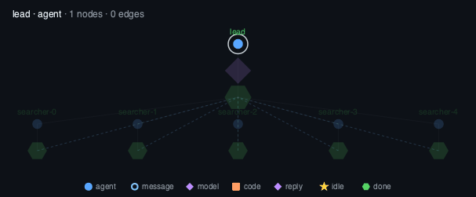</a>
<br /><b>Fan-out.</b> One agent splits an input into chunks, launches one agent per chunk, and waits for every result.
<br /><a href="examples/needle/"><code>examples/needle/</code></a>
</td>
<td width="50%" valign="top">
<a href="examples/patterns/tree.py">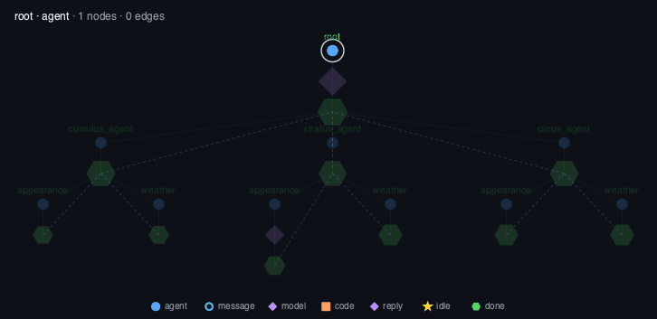</a>
<br /><b>Recursive tree.</b> A worker launches workers of its own, and each of those can do the same, until the depth limit.
<br /><a href="examples/patterns/tree.py"><code>examples/patterns/tree.py</code></a>
</td>
</tr>
<tr>
<td width="50%" valign="top">
<a href="examples/patterns/pipeline.py">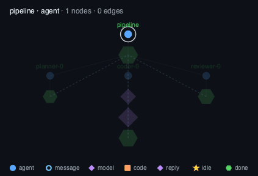</a>
<br /><b>Pipeline.</b> Each stage is launched with the results of the stages before it as variables.
<br /><a href="examples/patterns/pipeline.py"><code>examples/patterns/pipeline.py</code></a>
</td>
<td width="50%" valign="top">
<a href="examples/coding/boids/">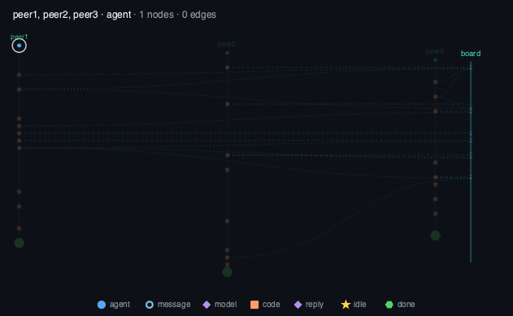</a>
<br /><b>Peers on a task board.</b> Top-level agents with no manager post, claim and finish tasks on a shared <code>TaskBoard</code>.
<br /><a href="examples/coding/boids/"><code>examples/coding/boids/</code></a>
</td>
</tr>
<tr>
<td width="50%" valign="top">
<a href="examples/patterns/review.py">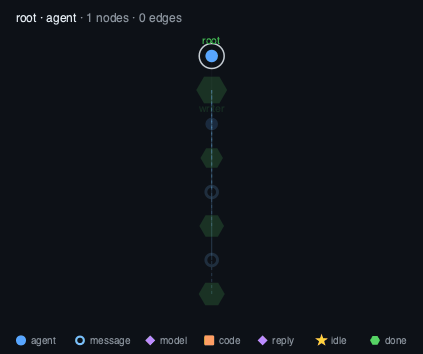</a>
<br /><b>Review loop.</b> A message reopens a finished agent, and its next result is the reply.
<br /><a href="examples/patterns/review.py"><code>examples/patterns/review.py</code></a>
</td>
<td width="50%" valign="top">
<a href="examples/shepherd/">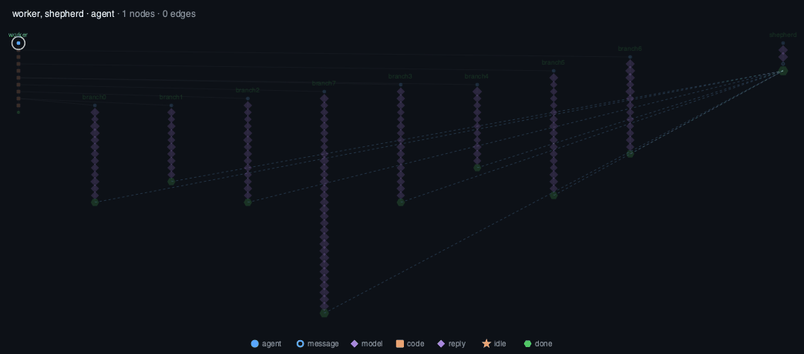</a>
<br /><b>Rewind and fork.</b> Branch any agent from any earlier step; its REPL is rebuilt and the original is untouched.
<br /><a href="examples/shepherd/"><code>examples/shepherd/</code></a>
</td>
</tr>
</table>

Every shape is a real run; [`examples/patterns/`](examples/patterns/) lists how to reproduce each one.

Read the blog post: [rlmflow](https://shyamsn97.github.io/blog/rflow/).

## Install

```bash
pip install "rlmflow[openai]"      # with OpenAI models
pip install "rlmflow[anthropic]"   # with Anthropic models
pip install "rlmflow[claude]"      # with Claude Code as a harness
pip install "rlmflow[all]"         # everything, including the viewer and image export
```

Set `OPENAI_API_KEY` or `ANTHROPIC_API_KEY` for the models you use. Claude Code agents use your Claude Code login; pi agents need [pi](https://github.com/badlogic/pi-mono) installed.

> **`LocalRuntime` is not a sandbox.** Agent code runs as ordinary Python with your filesystem, network and credentials. Use it only for code you would run yourself; for anything else use [`DockerRuntime` or `ModalRuntime`](docs/runtimes.md). See [Security](docs/security.md).

## Harnesses

A harness is what drives an agent: it takes the agent's next step and returns the node to land in the graph. Every agent is one, picked by its class, and one run can mix them. A Claude Code root can launch REPL workers, and a REPL root can launch Claude Code workers.

| Harness                  | What drives the agent                                                                                 | How to start it                    | Needs                                    |
| ------------------------ | ----------------------------------------------------------------------------------------------------- | ---------------------------------- | ---------------------------------------- |
| `Agent` (default)        | rlmflow calls the model, and the model calls a `repl(code)` tool that runs in the agent's Python REPL | `Agent(model="gpt-6-sol")`         | an OpenAI or Anthropic key               |
| `ClaudeCode`             | A headless Claude Code session per agent, with your Claude Code settings, tools and `CLAUDE.md`       | `ClaudeCode()`                     | `rlmflow[claude]`, signed in to `claude` |
| `Pi`                     | A headless [pi](https://github.com/badlogic/pi-mono) session per agent                                | `Pi()`                             | `pi` installed                           |
| Your Claude Code session | You, in your own terminal: your session becomes the root agent                                        | `/rlmflow:run TASK` in Claude Code | the `claude` CLI                         |
| Your own                 | Anything that can take a step: Codex, another CLI, a human, a script                                  | `MyAgent()`                        | an `Agent` subclass with its own `step`  |

Every harness reaches the same agent tools (`launch_agent`, `AGENTS`, `agent.send`, `submit`) in the same per-agent REPL, so every launch, message and result is recorded in the graph, whatever drove it.

### Your Claude Code session as the root agent

Load the plugin and start a run with a task:

```text
$ cd my-project
$ claude --plugin-dir "$(rlmflow plugin path)"
> /rlmflow:run There are 100 text files in haystack/. Exactly one line in one file matches the pattern
  `The magic number is <number>`. Find the number and the file it's in. Use rlmflow agents to search
  the files in parallel.
```

The plugin starts `rlmflow serve` for the project, and your session becomes the run's root agent. In a real run (Nov 8 2026, Claude Code root, gpt-5-mini workers, 34 s), the session went through three steps:

1. It ran Python in its REPL through `rlmflow repl`, splitting the files and launching four workers:

   ```text
   $ rlmflow repl <<'EOF'
   files = sorted(os.listdir("haystack"))
   chunks = [files[i:i+25] for i in range(0, len(files), 25)]
   kids = [launch_agent("Search these files in haystack/ for a line matching ... Files: " + ", ".join(c),
                        agent="worker") for c in chunks]
   EOF
   ```

1. It said "I've launched 4 agents, each searching 25 files. I'll wait for their results." and ended its turn. The plugin's Stop hook held the session until a worker finished and handed its result back: "Worker 1 searched files 0025–0049 and found nothing ... I'll keep waiting." That happened three times; the third result had the match.

1. It checked the match with its own `grep`, then submitted in the REPL, `submit({"number": 2536600, "file": "haystack/file_0060.txt", "line": 67})`, and replied with the answer. The last worker, still running, finished in the background.

<p align="center">
  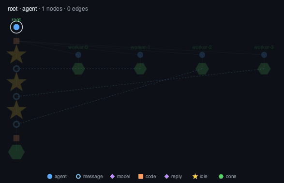
</p>

The run is saved as it goes under `.rlmflow/runs/<timestamp>/`; `rlmflow view show` on it prints the tree and timeline:

```text
└── root: done {'number': 2536600, 'file': 'haystack/file_0060.txt', 'line': 6… (4 turns)
    ├── root.worker-0: done …
    ├── root.worker-1: done …
    ├── root.worker-2: done …
    └── root.worker-3: done …

     1  +   0.00s  root · agent           start root · root · interactive
     2  +   4.38s  root · code            import os files = sorted(os.listdir("haystack")) …
     3  +   4.60s  root.worker-0 · agent  start worker-0 · worker · repl · model gpt-5-mini
     …
     7  +   6.55s  root · idle            idle, waiting for messages
     8  +  20.37s  root.worker-1 · done   done …
     9  +  20.66s  root · message         from rlmflow: Agents you started have finished. …
     …
    17  +  30.52s  root · code            submit({"number": 2536600, "file": "haystack/file_0060.txt", "line": 67})
    18  +  32.85s  root · done            done {'number': 2536600, 'file': 'haystack/file_0060.txt', 'line': 67}
```

[`examples/needle/claude_plugin.sh`](examples/needle/claude_plugin.sh) runs exactly these commands from a shell script (`claude -p`, then `rlmflow view show`), and [`claude_plugin.py`](examples/needle/claude_plugin.py) does the same from Python; both check the answer.

Anything you type after the root finishes is a message to it, and reopens it. Workers use the coding Flow built from `rlmflow.toml`, or your own Flow if you set `flow = "mypkg.agents:build"` there. The plugin does nothing in sessions that didn't run `/rlmflow:run`.

### Claude Code or pi as workers

Name them in the Flow's agents, and agents launch them by name like any other:

```python
from rlmflow import Agent, ClaudeCode, Flow, Pi

flow = Flow(
    agents={
        "default": Agent(model="gpt-6-sol"),  # rlmflow's REPL harness
        "claude": ClaudeCode(options={"permission_mode": "acceptEdits"}),
        "pi": Pi(),
    }
)

flow.run(
    "default",
    "Split the TODOs in src/ by directory, and give each directory to a `claude` agent to fix.",
)
```

The root's code runs `launch_agent("Fix the TODOs in `path`.", agent="claude", path=d)`. Each `claude` agent is a real Claude Code session in the working directory, with its own tools, permissions and `CLAUDE.md`. It reaches its REPL and the agent tools with `rlmflow repl`, as your own session does. To wait on workers of its own, it ends its turn, and the session is resumed with their results. To run the whole thing on Claude Code, start the root on that agent: `flow.run("claude", task)`.

Code a session runs through `rlmflow repl` is recorded in the graph. Edits it makes with its own tools are not recorded as nodes, but each turn's workspace snapshot has the files.

### Your own harness

An agent's `step(node, llm, repl)` takes its next step and returns the node to land. rlmflow doesn't ship one for Codex yet. One would be an `Agent` subclass like [`Pi`](rlmflow/agents/pi.py) (about 100 lines), which runs one CLI call per step and parses its JSON output:

```python
from rlmflow import Agent, Flow, Node
from rlmflow.agents import as_prompt, last_session
from rlmflow.agents.prompts import USE_RLMFLOW_REPL


class Codex(Agent):
    protocol = USE_RLMFLOW_REPL  # it reaches its REPL through the `rlmflow repl` command

    async def step(self, node, llm, repl):
        system, *new = self.messages(node, repl, since=last_session(node))
        argv = ["codex", "exec", "--json", f"{system['content']}\n\n{as_prompt(new)}"]
        stdout = await repl.run_command(argv)
        ...  # read the reply text, session id and token usage out of codex's JSON events
        out = Node("assistant", text, data={"session": session, "repl": repl.id, "usage": usage})
        return self.done(out, text, repl, since=node)


flow = Flow(agents={"default": Agent(model="gpt-6-sol"), "codex": Codex()})
```

See [Claude Code and pi as agents](docs/usage.md#claude-code-and-pi-as-agents), [Agents](docs/agents.md#claude-code-and-pi-sessions) and [Internals](docs/internals.md).

## Usage

Besides the harnesses above, there are three ways in: the Python library, the agent's own REPL, and the command line.

### From Python

`Flow` runs agents; each `Agent` is one kind of agent, named in `agents`. A run starts on the agent you name, and launches others by name.

```python
from rlmflow import Agent, Flow, LocalRuntime
from rlmflow.tools.files import FILE_TOOLS

flow = Flow(
    agents={
        "default": Agent(model="gpt-6-sol"),
        "worker": Agent(model="gpt-6.1-terra"),
    },
    tools=[FILE_TOOLS],
    runtime=LocalRuntime(working_directory="workdir"),
)

answer = flow.run("default", "Count the TODOs in every file under src/, one worker per directory.")
```

Keyword arguments to `run` become variables in the root's REPL: `flow.run("default", "Find the needle.", haystack=lines)`. To watch the run, steer it, or keep the graph, stream it:

```python
import asyncio
from rlmflow.view.text import kind


async def main():
    g = flow.start("default", "Build a text adventure game in Python, with combat and inventory.")
    async for node in flow.stream(g):
        print(node.path(), kind(node))  # every node as it finishes
    print(g.root.final_result())
    g.save("workdir/graph")  # reload with Graph.load


asyncio.run(main())
```

See [Usage](docs/usage.md) for agents, models, prompts, runtimes, stopping, and saving and resuming.

### Inside an agent's REPL

The agent writes ordinary Python. These are the calls that build the graph:

| Call                                           | What it does                                                                                                                         |
| ---------------------------------------------- | ------------------------------------------------------------------------------------------------------------------------------------ |
| `launch_agent(task, agent="worker", **args)`   | Start an agent with a fresh context; `**args` become its variables. Returns a handle at once.                                        |
| `await agent`, `await asyncio.gather(*agents)` | Wait for the results of agents you launched.                                                                                         |
| `agent.send(message, **inputs)`                | Message an agent, reopening it if it finished; `**inputs` become its variables. For an agent you launched, `await` it for the reply. |
| `AGENTS["name"]`                               | Any agent in the run, by name, path or id, with its status, result, parent and children.                                             |
| `llm_query(prompt, schema=...)`                | One model call with no conversation.                                                                                                 |
| `submit(value)`                                | Finish with a result.                                                                                                                |

```python
chunks = [haystack[i : i + 100_000] for i in range(0, len(haystack), 100_000)]
workers = [
    launch_agent("Find the magic number in `chunk`.", agent="worker", chunk=c) for c in chunks
]
results = await asyncio.gather(*workers)
submit(next(r for r in results if r))
```

See [Agents](docs/agents.md).

### From the command line

`rlmflow` is also a coding agent you can run over a directory, plus tools for reading any saved run:

```bash
rlmflow run print "fix the failing test"     # a coding agent over .: stream it, print the answer
rlmflow run --model gpt-6-sol --workdir ./proj print "add a test for parse_args"
rlmflow run --resume ./graph print "now update the docs"

rlmflow view show runs/x                     # the agent tree, then the timeline
rlmflow fork runs/x NODE --agent worker      # copy a saved run cut after a node, and run the copy
rlmflow render gif runs/x run.gif            # or html, svg, browser
```

Settings come from flags, then `RLMFLOW_*` variables, then `./rlmflow.toml`, then `~/.config/rlmflow/config.toml`. See [Command line](docs/cli.md).

## Results

Real runs of the examples below: Needle on Nov 18 2026, Autoresearch on Nov 19, Boids and Shepherd on Nov 20. [Example results](docs/example_results.md) has the per-run tables, figures and caveats.

| Example                                                    | What it shows                            | Result                                                                                                                   |
| ---------------------------------------------------------- | ---------------------------------------- | ------------------------------------------------------------------------------------------------------------------------ |
| [Needle](#needle-fan-out-on-any-harness)                   | Fan-out, with harnesses mixed per agent  | REPL root and workers, a Claude Code root, and Claude Code workers each find the needle, with the same graph shape.      |
| [Boids](#boids-peers-build-an-app-on-a-shared-task-board)  | Peers with no manager share a task board | Claude Code peers: one claims the plan, the others claim its tasks; a working app, 30 board writes, 3.3 minutes.         |
| [Autoresearch](#autoresearch-a-planner-running-gpu-trials) | A planner running long GPU trials        | Validation bits per byte 0.903 → 0.764 in 32 trials on A10G.                                                             |
| [Shepherd](#shepherd-rewind-and-fork-a-failed-run)         | Rewind and fork a failed run             | A worker jams a Sokoban puzzle after 8 pushes; all 8 forked branches solve it, and the shepherd picks the 12-push solve. |

## Examples

### Needle: fan out on any harness

The root splits 100 files into batches, launches a searcher per batch, and submits the number they find. `--all` runs every combination of root harness and worker harness. The graph has the same shape whichever harness runs which agent:

<p align="center">
  
</p>

```bash
pip install "rlmflow[openai,claude]"
python examples/needle/filesystem.py --all
```

[`haystack.py`](examples/needle/haystack.py) is the same idea at scale: one million lines passed in as a Python value, split across gpt-6-luna workers.

[Example](examples/needle/)

### Boids: peers build an app on a shared task board

Three top-level agents get the same product spec for a browser boids simulation and a shared task board, and are told there is no manager. One of them plans: each tries to post and claim a `plan` task, the first claim wins, and the winner publishes the interface and posts a task per file. The rest wait for `plan` to finish, then claim tasks, publish the interfaces they define, and finish what they claimed. Their other tools are generic: file tools, their REPL, and a headless browser that shows them screenshots of the page and returns its console output. Nothing grades the app for them.

```python
from rlmflow import ClaudeCode, Flow, Graph
from rlmflow.tools.board import TaskBoard
from rlmflow.tools.files import FILE_TOOLS

flow = Flow(
    tools=[FILE_TOOLS, TaskBoard()],
    agents={"peer": ClaudeCode(max_depth=0)},
    workers=3,
)
g = Graph()
for name in ("peer1", "peer2", "peer3"):
    g.start(
        f"You are {name}, one of three peers. Coordinate on the task board.",
        name=name,
        agent="peer",
    )
flow.run(g)
print(TaskBoard.state(g)["tasks"])
```

Inside a run, the peers call the board from their REPL:

```python
board_read()  # tasks, findings, and upto: the last write seen
board_post("plan", "split the app into tasks and publish the interface")
board_claim("plan")["ok"]  # False if another peer claimed it first
board_publish("interface", "window.BOIDS; load order config, grid, sim, render, main")
board_post("js/boids.js", "BOIDS.Flock: the simulation, using the grid")
board_finish("plan", "interface published; 7 file tasks posted")
```

Every board call is saved on the node that made it, so the board is part of the graph: `TaskBoard.state(g)` replays it, it loads with a saved run, and a fork has the board as it was at the cut. The figure draws it as a lane beside the agents.

<p align="center">
  
</p>

<p align="center">
  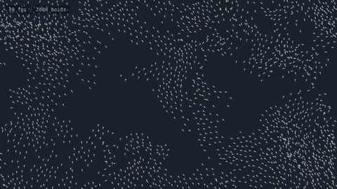
</p>

In the Claude Code run above, all three peers went for `plan` at once and `peer2` won it: `peer1`'s post and claim and `peer3`'s post came back `ok: False`. `peer2` published the interface and posted seven file tasks while the others polled the board. Then `peer3` claimed the grid and the renderer a moment before `peer1` asked for the same two, so `peer1` took the loop and the stylesheet. They made 30 board writes, sent no direct messages, and finished a working app in 3.3 minutes. The spec asks for a calm look: muted colors on a slate background, no trails or glow. An earlier run without the `plan` task had two peers post rival plans at the same moment; one of them retired its own on the board ([results](docs/example_results.md#boids-peers-on-a-shared-task-board)).

```bash
pip install "rlmflow[claude,image]"
python examples/coding/boids/boids.py --harness claude_code
```

[Example](examples/coding/)

### Autoresearch: a planner running GPU trials

A planner agent proposes changes to a small GPT trained on TinyStories. Each trial is implemented by a child agent, a Claude Code session by default or the REPL harness, in its own copy of the files, and trained for 3 minutes on a Modal A10G. The planner reads the scores and plans the next trials.

<p align="center">
  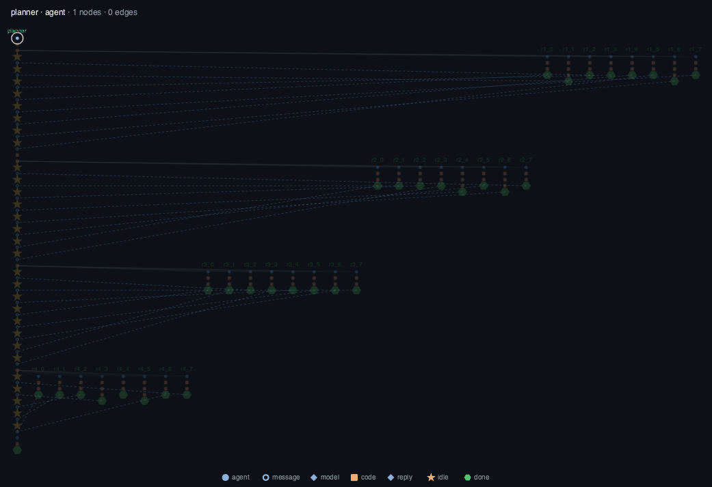
</p>

<p align="center">
  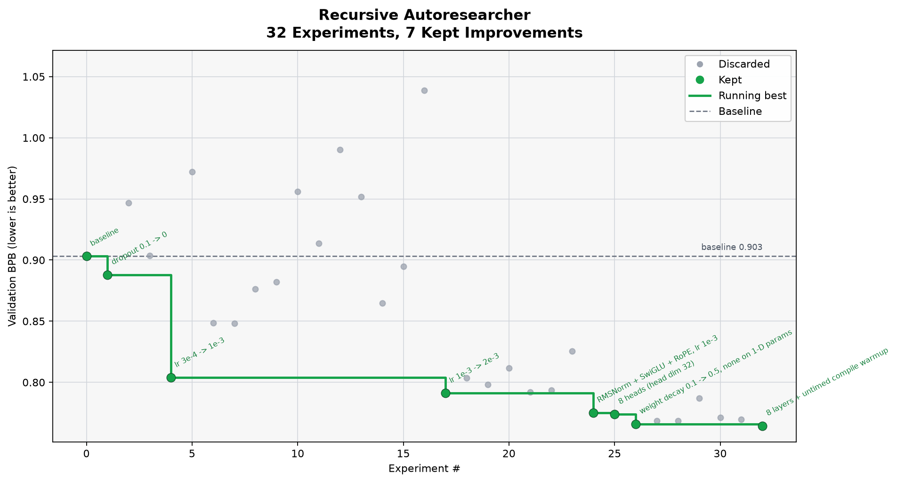
</p>

In 32 trials the run went from the 0.903 baseline to 0.764. A higher learning rate, a modern block (RMSNorm, SwiGLU, RoPE), weight decay 0.5 and 8 layers each helped; dropout 0 at a high learning rate overfit the 2M-token training set.

```bash
pip install "rlmflow[claude,modal]"
python examples/autoresearch/run.py --gpu A10G --parallel 8 --max-submissions 48 --max-usd 20 --minutes 120
```

[Example](examples/autoresearch/)

### Shepherd: rewind and fork a failed run

A worker plays Sokoban and jams a box against a wall after 8 pushes. A gpt-5 shepherd reads the stuck transcript, previews the board at each rewind depth, and forks the worker 8 times. Each fork rewinds the worker to an earlier point, from 1 push back to the fresh board, and gets its own plan. The forks run in parallel as gpt-5 agents. When they finish, the shepherd reads every branch's outcome and final board and picks the one to keep.

<p align="center">
  
</p>

<p align="center">
  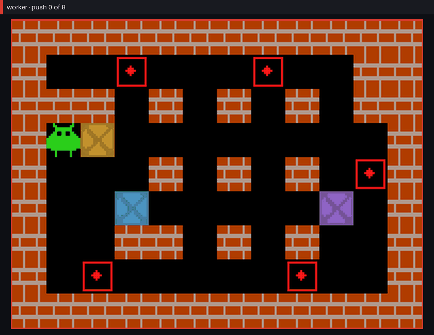
</p>

All eight branches solved it, in 12 to 36 pushes. The shepherd picked branch6, which rewound to the fresh board and solved in 12: "Picked branch6: solved with the fewest total pushes (12) among all solved branches." A retry from the jam point alone would have failed.

```bash
pip install "rlmflow[openai,image]"
python examples/shepherd/shepherd.py --trace
```

[Example](examples/shepherd/) · [Walkthrough](docs/shepherd.md) · More in the [examples guide](examples/README.md)

## How the graph is built

A graph holds nodes and edges. A node is one chat message: the text the model reads, inputs that become REPL variables, and the code the REPL runs. An agent is its first node, and owns the nodes after it:

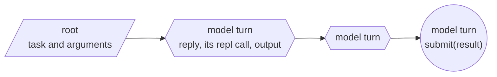

Each model call is one assistant node: the reply, the code from its `repl(code)` tool call, and what that code printed. `submit(...)` in the code, or a reply with no tool call, marks that node terminal with the agent's result. Everything that arrives from outside is a user node: a batch of results, a peer's message, a controller's nudge, with any values it carries bound as variables. A Claude Code or pi session that ends its turn waiting for messages marks its last node idle. Edges are what crosses between agents: `spawn` from the node that launched an agent, `return` from a child's terminal node to wherever its result went, and `write` from the node that sent a message. Below, solid arrows join an agent's nodes and dotted arrows are edges.

**`launch_agent` + `await`.** Launching adds an agent and a `spawn` edge from the node whose code launched it. Awaiting it in the same code returns the child's result in place, and a `return` edge records that the node used it:

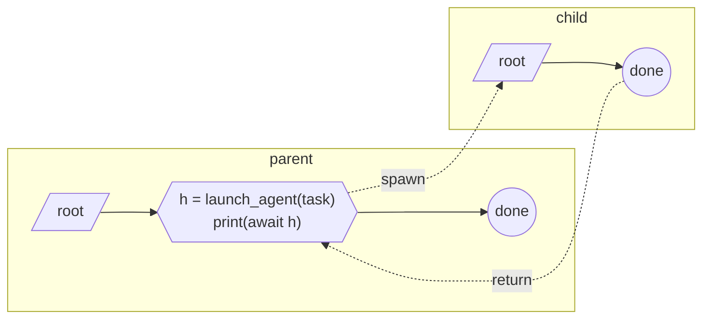

**`launch_agent` without awaiting.** The child runs in the background. When it finishes, its result reaches the parent in a user node before the parent's next turn, bound as a variable named after the child:

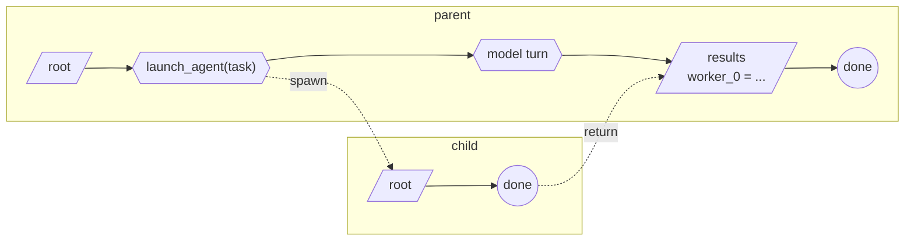

**`agent.send(message, **inputs)`.** A message is a user node added to the target, even if the target already finished: a finished agent reopens and takes another turn. You can await only agents you launched (and theirs), so `await child.send(...)` returns the child's reply, while peers answer with a message of their own:

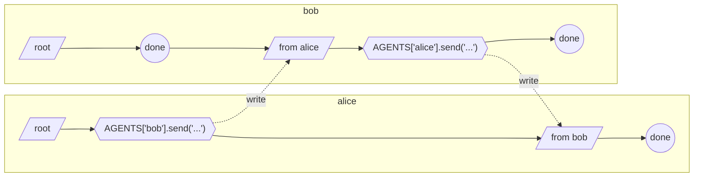

**`g.fork(node)`.** A fork is a new graph: a copy of the run with the same ids, with `node`'s agent cut right after `node`. What that agent did after `node` is gone, including the agents it launched, while every other agent is copied as it is, and the original is untouched. Steer the copy with a message and run it on its own; its REPLs are rebuilt by running their agents' nodes again. Shepherd forks one jammed worker eight times, each rewound to an earlier point:

```python
branch = g.fork(node)
branch.send(branch[node.root_id].root, "Try a different approach.")
flow.run(branch)
```

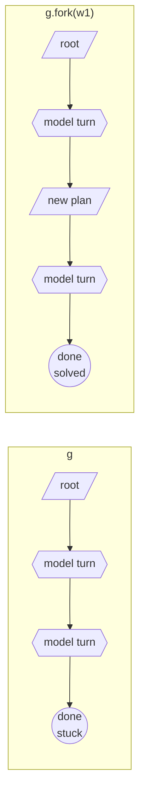

**Editing.** The graph is plain data and fully editable, with no `Flow` running. `g.edit(node, ...)`, `g.delete(node)`, `g.remove(agent)` and `g.replace(node, i, value)` change it, and the edges say what depended on the change: the agent rewinds to the edited node, and a node whose code used an edited result reruns in place on the next `flow.run(g)`. Each returns what it invalidated, and `dry_run=True` only reports it:

```python
child = root.children()[0]
print(g.edit(child.last_turn(), result="42", dry_run=True))  # what would redo
g.edit(child.last_turn(), result="42")
flow.run(g)  # the parent's code reruns with 42
```

Host code can also `g.send(agent, text, **inputs)`, `g.fork(node)`, `g.start(...)`, `g.link("peer", a, b)`, `g.save(path)` and `Graph.load(path)`. See [Usage](docs/usage.md#change-a-run) and the [graph tour](examples/graph/).

## Tools

A tool is a Python function. Its docstring and signature describe it to the agent, and it runs in your process, so it can use your clients and connections:

```python
def lookup_customer(customer_id: str) -> dict:
    """Look up a customer by id."""
    return crm.get(customer_id)


flow = Flow(tools=[FILE_TOOLS, lookup_customer])
```

`@tool(...)` sets a name, description or visibility; `tool_from_schema` wraps a JSON Schema tool; and a toolkit brings tools that need a live connection, such as every tool on an MCP server:

```python
from rlmflow.integrations.mcp import MCPTools

flow = Flow(tools=[MCPTools("python", "weather_server.py")])
```

A tool can show the agent an image with `attach_image(path)`, which is how Boids' browser tool shows screenshots. See [Tools](docs/control.md#tools).

## See a run

Every view is a render of the graph, live or saved:

```bash
rlmflow view show runs/x                   # the agent tree and timeline
rlmflow render html runs/x run.html        # a single-file stepper
rlmflow render gif runs/x run.gif          # an animation, like the ones above
rlmflow render browser runs/x              # the browser viewer
```

See [Observability](docs/observability.md) and the [command line](docs/cli.md).

## Docs

- [Usage](docs/usage.md): running, agents, models, tools, runtimes, streaming, forking, Claude Code and pi, the CLI.
- [Agents](docs/agents.md): what an agent does in a run: its REPL tools, launching, waiting and messaging.
- [Runtimes](docs/runtimes.md) · [Security](docs/security.md) · [Observability](docs/observability.md) · [Internals](docs/internals.md)
- [Changelog](CHANGELOG.md) · [All docs](docs/index.md)

## References

- [Recursive Language Models](https://github.com/alexzhang13/rlm): the paper and implementation that inspired this project, and [rlm-minimal](https://github.com/alexzhang13/rlm-minimal), the single file rlmflow grew from.
- [Tau](https://github.com/huggingface/tau): rlmflow's separation of execution, durable state and consumers follows its harness design.
- [Scaling Managed Agents](https://www.anthropic.com/engineering/managed-agents): separating harness, session and sandbox.
- [ypi](https://github.com/rawwerks/ypi): a recursive coding agent on pi; our session layout and parts of the default prompt come from it.
- [Shepherd](https://arxiv.org/abs/2605.10913) (Yu et al., 2026) motivates the Shepherd example.

## License

See [LICENSE](LICENSE).

## Citation

```bibtex
@misc{sudhakaran2026rlmflow,
  author = {Sudhakaran, Shyam},
  title = {rlmflow},
  year = {2026},
  publisher = {GitHub},
  journal = {GitHub repository},
  howpublished = {\url{https://github.com/shyamsn97/rlmflow}},
}
```
