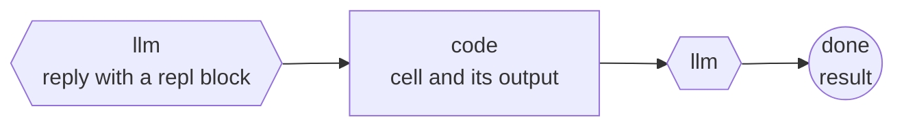
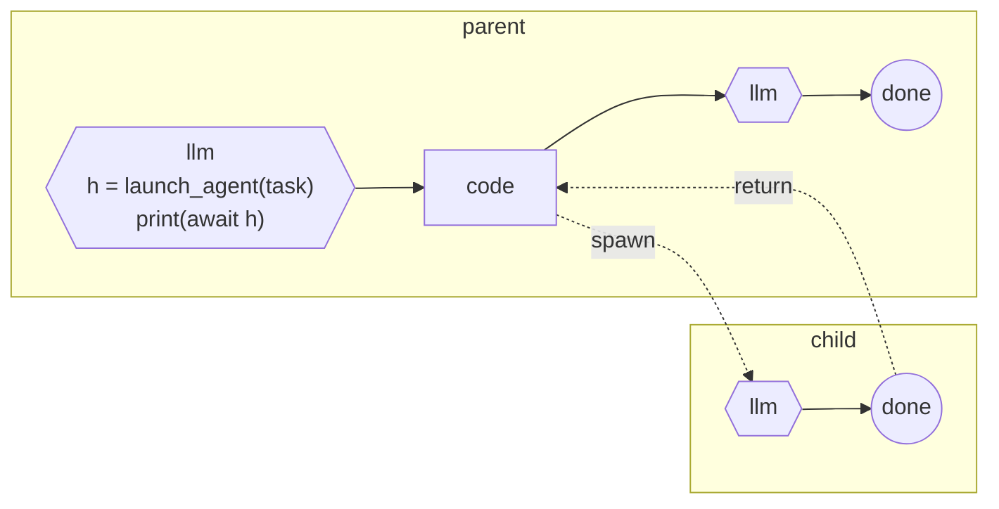
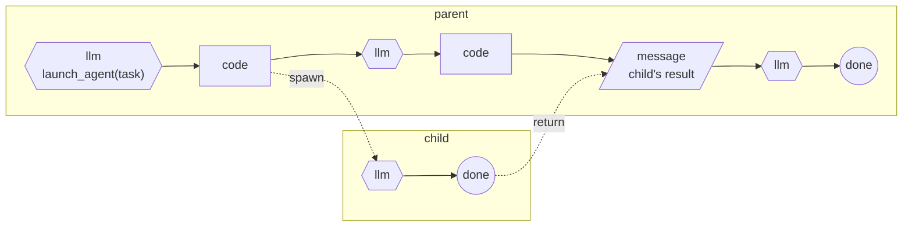
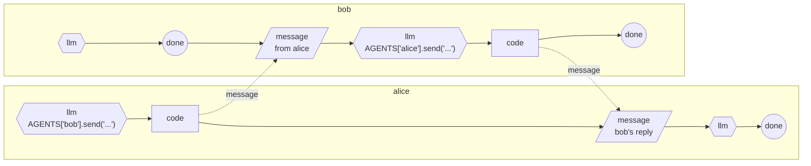
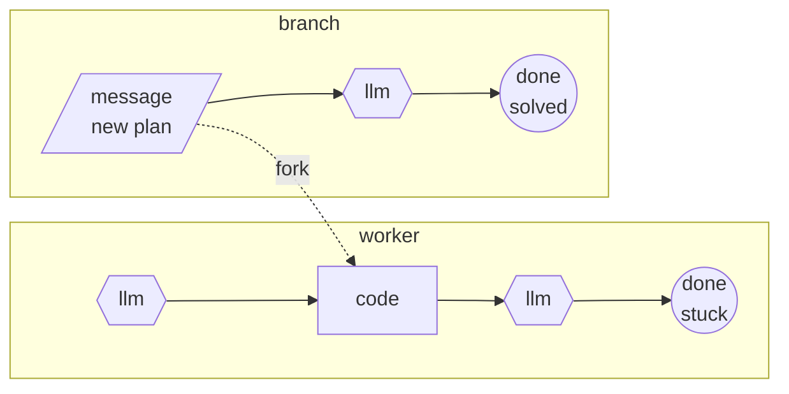

# rlmflow

<p align="center">
  <a href="https://pypi.org/project/rlmflow/"></a>
  <a href="https://github.com/shyamsn97/rlmflow/pkgs/container/rlmflow"></a>
</p>

**rlmflow is a graph-native runtime for multi-agent systems.** Instead of treating execution as a fixed sequence of agent calls, rlmflow represents agents, messages, and results as an evolving graph that drives execution. This makes it possible to inspect and modify the system as it runs, or branch execution from any point in its history.

<table>
<tr>
<td width="50%" valign="top">
<a href="examples/needle/harnesses/"></a>
<br /><b>Fan-out.</b> One agent splits an input into chunks, launches one agent per chunk, and waits for every result.
<br /><a href="examples/needle/harnesses/"><code>examples/needle/harnesses/</code></a>
</td>
<td width="50%" valign="top">
<a href="examples/architectures/tree.py"></a>
<br /><b>Recursive tree.</b> A worker launches workers of its own, and each of those can do the same, until the depth limit.
<br /><a href="examples/architectures/tree.py"><code>examples/architectures/tree.py</code></a>
</td>
</tr>
<tr>
<td width="50%" valign="top">
<a href="examples/architectures/pipeline.py"></a>
<br /><b>Pipeline.</b> Each stage is launched with the results of the stages before it as variables.
<br /><a href="examples/architectures/pipeline.py"><code>examples/architectures/pipeline.py</code></a>
</td>
<td width="50%" valign="top">
<a href="examples/coding/boids/"></a>
<br /><b>Peers.</b> Top-level agents with no manager coordinate by messaging each other.
<br /><a href="examples/coding/boids/"><code>examples/coding/boids/</code></a>
</td>
</tr>
<tr>
<td width="50%" valign="top">
<a href="examples/architectures/review.py"></a>
<br /><b>Review loop.</b> A message reopens a finished agent, and its next result is the reply.
<br /><a href="examples/architectures/review.py"><code>examples/architectures/review.py</code></a>
</td>
<td width="50%" valign="top">
<a href="examples/shepherd/"></a>
<br /><b>Rewind and fork.</b> Branch any agent from any earlier step; its REPL is rebuilt and the original is untouched.
<br /><a href="examples/shepherd/"><code>examples/shepherd/</code></a>
</td>
</tr>
</table>

Every shape is a real run; [`examples/architectures/`](examples/architectures/) lists how to reproduce each one.

Read the blog post: [rlmflow](https://shyamsn97.github.io/blog/rlmflow/).

## Install

```bash
pip install "rlmflow[openai]"      # with OpenAI models
pip install "rlmflow[anthropic]"   # with Anthropic models
pip install "rlmflow[claude]"      # with Claude Code as a harness
pip install "rlmflow[all]"         # everything, including the viewer and image export
```

Set `OPENAI_API_KEY` or `ANTHROPIC_API_KEY` for the models you use. Claude Code agents use your Claude Code login; pi agents need [pi](https://github.com/badlogic/pi-mono) installed.

> **`LocalRuntime` is not a sandbox.** Agent code runs as ordinary Python with your filesystem, network and credentials. Use it only for code you would run yourself; for anything else use [`DockerRuntime` or `ModalRuntime`](docs/runtimes.md). See [Security](docs/security.md).

## Usage

There are four ways in: the Python library, the agent's own REPL, the command line, and other agent harnesses.

### From Python

`Flow` runs agents; `AgentConfig` describes one kind of agent. The first config is the root's; the others are kinds the root can launch.

```python
from rlmflow import FILE_TOOLS, AgentConfig, Flow, LocalRuntime

flow = Flow(
    configs=[
        AgentConfig(model="gpt-5"),
        AgentConfig(name="worker", model="gpt-5-mini"),
    ],
    tools=[FILE_TOOLS],
    runtime=LocalRuntime(working_directory="workdir"),
)

answer = flow.run("Count the TODOs in every file under src/, one worker per directory.")
```

Keyword arguments to `run` become variables in the root's REPL: `flow.run("Find the needle.", haystack=lines)`. To watch the run, steer it, or keep the graph, stream it:

```python
import asyncio
from rlmflow import Graph


async def main():
    g = Graph()
    root = g.add_agent("Build a text adventure game in Python, with combat and inventory.")
    async for step in flow.run_streaming(g):
        print(g.path(step.agent), step.node.type)  # every node as it lands
    print(g.result(root))
    g.save("workdir/graph")  # reload with Graph.load


asyncio.run(main())
```

See [Usage](docs/usage.md) for configs, models, prompts, runtimes, stopping, and saving and resuming.

### Inside an agent's REPL

The agent writes ordinary Python. These are the calls that build the graph:

| Call | What it does |
| --- | --- |
| `launch_agent(task, config="worker", **args)` | Start an agent with a fresh context; `**args` become its variables. Returns the `Agent` at once. |
| `await agent`, `await asyncio.gather(*agents)` | Wait for the results of agents you launched. |
| `agent.send(message)` | Message an agent, reopening it if it finished. For an agent you launched, `await` it for the reply. |
| `AGENTS["name"]` | Any agent in the run, by name, path or id, with its status, result, parent and children. |
| `llm_query(prompt, schema=...)` | One model call with no history. |
| `submit(value)` | Finish with a result. |

```python
chunks = [haystack[i : i + 100_000] for i in range(0, len(haystack), 100_000)]
workers = [
    launch_agent("Find the magic number in `chunk`.", config="worker", chunk=c) for c in chunks
]
results = await asyncio.gather(*workers)
submit(next(r for r in results if r))
```

See [Agents](docs/agents.md).

### From the command line

`rlmflow` is also a coding agent you can run over a directory, plus tools for reading any saved run:

```bash
rlmflow run print "fix the failing test"     # a coding agent over .: stream it, print the answer
rlmflow run --model gpt-5 --workdir ./proj print "add a test for parse_args"
rlmflow run --resume ./graph print "now update the docs"

rlmflow view show runs/x                     # the agent tree, then the timeline
rlmflow fork runs/x NODE --config worker     # branch a saved run at a node and run the branch
rlmflow render gif runs/x run.gif            # or html, svg, browser
```

Settings come from flags, then `RLMFLOW_*` variables, then `./rlmflow.toml`, then `~/.config/rlmflow/config.toml`. See [Command line](docs/cli.md).

### With Claude Code, pi, or your own harness

A config's `harness` picks what runs its agents, so one run can mix them:

```python
flow = Flow(
    configs=[
        AgentConfig(model="gpt-5"),  # rlmflow's REPL harness
        AgentConfig(name="claude", harness="claude_code"),  # a Claude Code session per agent
        AgentConfig(name="pi", harness="pi"),  # a pi session per agent
    ]
)
```

Claude Code and pi agents keep their own tools, settings and `CLAUDE.md`, and reach the REPL and agent tools through the `rlmflow repl` command, so their cells, launches and messages land in the same graph as everyone else's.

**Your Claude Code session as the root.** Load the plugin and start a run; your session becomes the root agent and can launch workers:

```text
$ claude --plugin-dir "$(rlmflow plugin path)"
> /rlmflow:run Find the magic number in haystack/ and tell me which file it's in.
```

**Your own harness.** A harness is anything that takes an agent's next step and returns the node to land. rlmflow doesn't ship one for Codex yet; one would be a `SessionHarness` like [`pi.py`](rlmflow/harnesses/pi.py) (about 100 lines), which runs one CLI turn per step and parses its JSON output:

```python
from rlmflow.harnesses.sessions import Session, SessionHarness, TurnResult, next_prompt


class CodexHarness(SessionHarness):
    name = "codex"

    async def run_turn(self, flow, step, turn):
        session = Session.for_step(step)
        prompt = await next_prompt(flow, step, session)
        argv = ["codex", "exec", "--json", f"{self.prompt(flow, step)}\n\n{prompt}"]
        stdout = await self.run_command(flow, step, argv, turn.env)
        ...  # read the reply text and token usage out of codex's JSON events
        return TurnResult(session_id=session.id, text=text, usage=usage)


flow = Flow(configs=[AgentConfig(model="gpt-5"), AgentConfig(name="codex", harness=CodexHarness)])
```

See [Claude Code and pi as agents](docs/usage.md#claude-code-and-pi-as-agents) and [Internals](docs/internals.md).

## Results

Real runs of the examples below, Nov 2–4 2026. [Example results](docs/design/example-results.md) has the per-run tables, figures and caveats.

| Example | What it shows | Result |
| --- | --- | --- |
| [Shepherd](#shepherd-rewind-and-fork-a-failed-run) | Rewind and fork a failed run | A worker jams a Sokoban puzzle after 8 pushes; 3 of 8 forked branches solve it. Every branch that rewound 6 or more pushes solved; every branch that kept 3 or more of the jammed pushes stayed stuck. |
| [Needle](#needle-fan-out-on-any-harness) | Fan-out, with harnesses mixed per agent | 4 of 4 root × worker combinations of the REPL harness and Claude Code find the needle, with the same graph shape. |
| [Autoresearch](#autoresearch-a-planner-running-gpu-trials) | A planner running long GPU trials | Validation bits per byte 1.155 → 0.920 with REPL implementers, → 0.866 with Claude Code implementers, in 8 trials each. |
| [Boids](#boids-peers-build-an-app-with-no-manager) | Peers with no manager build an app by messaging | Claude Code peers: a working app, 21 messages in the graph. gpt-5 peers: 4 of 6 runs flock; 3 of 6 meet the whole spec. |

## Examples

### Shepherd: rewind and fork a failed run

A worker plays Sokoban and jams a box against a wall after 8 pushes. A gpt-5 shepherd reads the stuck transcript, previews the board at each rewind depth, and forks the worker at 8 different points in its history, each with its own plan. The forks run in parallel as gpt-5-mini agents, and the shepherd picks the best.

<p align="center">
  
</p>

<p align="center">
  
</p>

The three branches that rewound six, seven and eight pushes solved it; the picked one restarted from the fresh board and solved in 9 pushes. A retry from the jam point alone would have failed.

```bash
pip install "rlmflow[openai,image]"
python examples/shepherd/shepherd.py --trace
```

[Example](examples/shepherd/) · [Walkthrough](docs/shepherd.md)

### Needle: fan out on any harness

The root splits 100 files into chunks, launches 10 searchers, and submits the number they find. `--all` runs every combination of root harness and worker harness. The graph has the same shape whichever harness runs which agent:

<p align="center">
  
</p>

```bash
pip install "rlmflow[openai,claude]"
python examples/needle/harnesses/run.py --all
```

[`haystack.py`](examples/needle/haystack.py) is the same idea at scale: one million lines passed in as a Python value, split across gpt-5-nano workers.

[Example](examples/needle/)

### Autoresearch: a planner running GPU trials

A gpt-5 planner proposes changes to a small GPT trained on TinyStories. Each trial is implemented by a child agent, on the REPL harness or as a Claude Code session, and trained for 5 minutes on a Modal GPU. The planner reads the scores and plans the next trials.

<p align="center">
  
</p>

```bash
pip install "rlmflow[openai,claude,modal]"
python examples/autoresearch/run.py --max-submissions 8 --parallel 4 --implementer-harness claude_code
```

[Example](examples/autoresearch/)

### Boids: peers build an app with no manager

Three top-level agents get the same product spec for a browser boids simulation, plus one line: there are three of you and no manager, so split the work, agree on interfaces by messaging each other, and write only your own files. Their tools are generic: file tools, their REPL, and a headless browser that shows them screenshots of the page and returns its console output. Nothing grades the app for them.

<p align="center">
  
</p>

The three Claude Code peers above each proposed a split at once, converged on one written into `INTERFACE.md`, and exchanged 21 messages in 3.5 minutes. gpt-5 peers on the REPL harness negotiate too, and 4 of 6 runs flock.

```bash
pip install "rlmflow[claude,image]"
python examples/coding/boids/boids.py --harness claude_code
```

[Example](examples/coding/) · More in the [examples guide](examples/README.md)

## How the graph is built

A graph holds agents, the nodes in each agent's history, and edges between them. An agent's history is a list of nodes:



A model call lands an `llm` node; running its cell lands a `code` node; `submit(...)`, or a reply with no `repl` block, lands `done`. A `message` node is anything that arrives from outside: a batch of results, a peer's message, a controller's nudge. A Claude Code or pi session that ends its turn waiting for messages lands `idle`. Edges are what crosses between agents: `spawn` from the cell that launched an agent, `return` from a child's `done` to wherever its result went, `message` from the cell that sent one, and `fork` from a branch to the node it branched at. Below, solid arrows are an agent's history and dotted arrows are edges.

**`launch_agent` + `await`.** Launching adds an agent and a `spawn` edge from the cell. Awaiting it inside the cell returns the child's result in place, and a `return` edge records that the cell used it:



**`launch_agent` without awaiting.** The child runs in the background. When it finishes, its result reaches the parent in a `message` at the parent's next turn:



**`agent.send(message)`.** A message lands in the target's history at its next turn, even if the target already finished: a finished agent reopens and takes another turn. You can await only agents you launched (and theirs), so `await child.send(...)` returns the child's reply, while peers answer with a message of their own:



**`g.fork(node)`.** A fork is a new agent that branches off any node. It shares the history up to that node, so its REPL is rebuilt by replaying those cells, and then it continues on its own; the original is untouched. Shepherd forks one jammed worker at eight different points:



**Editing.** The graph is plain data and fully editable, with no `Flow` running. `g.edit(node, ...)`, `g.delete(node)`, `g.remove(agent)` and `g.replace(call, value)` change it, and the edges say what depended on the change: the agent rewinds to the edited node, and a cell that used an edited result re-runs in place on the next `flow.run(g)`. Each returns what it invalidated, and `dry_run=True` only reports it:

```python
child = g.children(root)[0]
print(g.edit(g.history(child)[-1], result="42", dry_run=True))  # what would redo
g.edit(g.history(child)[-1], result="42")
flow.run(g)  # the parent's cell re-runs with 42
```

Host code can also `g.send(agent, text)`, `g.fork(node)`, `g.add_agent(...)`, `g.add_edge("peer", a, b)`, `g.save(path)` and `Graph.load(path)`. See [Usage](docs/usage.md#change-a-run) and the [graph tour](examples/graph/).

## Tools

A tool is a Python function. Its docstring and signature describe it to the agent, and it runs in your process, so it can use your clients and connections:

```python
def lookup_customer(customer_id: str) -> dict:
    """Look up a customer by id."""
    return crm.get(customer_id)


flow = Flow(tools=[FILE_TOOLS, lookup_customer])
```

`@tool(...)` sets a name, description or visibility; `tool_from_schema` wraps a JSON Schema tool; and a toolkit brings tools that need a live connection, such as every tool on an MCP server:

```python
from rlmflow.integrations.mcp import MCPTools

flow = Flow(tools=[MCPTools("python", "weather_server.py")])
```

A tool can show the agent an image with `attach_image(path)`, which is how Boids' browser tool shows screenshots. See [Tools](docs/control.md#tools).

## See a run

Every view is a render of the graph, live or saved:

```bash
rlmflow view show runs/x                   # the agent tree and timeline
rlmflow render html runs/x run.html        # a single-file stepper
rlmflow render gif runs/x run.gif          # an animation, like the ones above
rlmflow render browser runs/x              # the browser viewer
```

See [Observability](docs/observability.md) and the [command line](docs/cli.md).

## Docs

- [Usage](docs/usage.md): running, configs, models, tools, runtimes, streaming, forking, Claude Code and pi, the CLI.
- [Agents](docs/agents.md): what an agent does in a run: its REPL tools, launching, waiting and messaging.
- [Runtimes](docs/runtimes.md) · [Security](docs/security.md) · [Observability](docs/observability.md) · [Internals](docs/internals.md)
- [Changelog](CHANGELOG.md) · [Upgrading](UPGRADING.md) · [All docs](docs/index.md)

## References

- [Recursive Language Models](https://github.com/alexzhang13/rlm): the paper and implementation that inspired this project, and [rlm-minimal](https://github.com/alexzhang13/rlm-minimal), the single file rlmflow grew from.
- [Tau](https://github.com/huggingface/tau): rlmflow's separation of execution, durable state and consumers follows its harness design.
- [Scaling Managed Agents](https://www.anthropic.com/engineering/managed-agents): separating harness, session and sandbox.
- [ypi](https://github.com/rawwerks/ypi): a recursive coding agent on pi; our session layout and parts of the default prompt come from it.
- [Shepherd](https://arxiv.org/abs/2605.10913) (Yu et al., 2026) motivates the Shepherd example.

## License

See [LICENSE](LICENSE).

## Citation

```bibtex
@misc{sudhakaran2025rlmflow,
  author = {Sudhakaran, Shyam},
  title = {rlmflow},
  year = {2025},
  publisher = {GitHub},
  journal = {GitHub repository},
  howpublished = {\url{https://github.com/shyamsn97/rlmflow}},
}
```
