# Example results

Real runs of the flagship examples, Nov 2 2026, on this machine. Run outputs (graphs, logs, traces) are in `examples/_runs/results/` and `examples/_runs/release-check/` (git-ignored); the figures below are copied into `docs/static/results/`.

| Example            | Shows                                                                   | Harnesses                                      | Result                                                                                                                                |
| ------------------ | ----------------------------------------------------------------------- | ---------------------------------------------- | ------------------------------------------------------------------------------------------------------------------------------------- |
| Shepherd (Sokoban) | Rewind, fork, parallel recovery, the shepherd picks                     | REPL, gpt-5 shepherd + gpt-5 workers           | Worker jammed. 8 of 8 forked branches solved; the shepherd picked the 12-push solve                                                   |
| Needle             | Recursive fan-out; harnesses mixed per agent                            | REPL and Claude Code, root × workers           | 4 of 4 combinations correct                                                                                                           |
| Autoresearch       | Planner plus long-running GPU jobs                                      | REPL planner; REPL or Claude Code implementers | val_bpb 1.155 → 0.920 (REPL), → 0.866 (Claude Code)                                                                                   |
| Peers              | Agents messaging each other with `send_agent`                           | REPL, gpt-5-mini                               | Correct total (6); both peers acknowledged it                                                                                         |
| Boids              | Peers with no manager split the work and agree on interfaces by message | REPL (gpt-5) or Claude Code                    | Claude Code: a working app with 21 messages in the graph. gpt-5: 1 of 3 worked, then 3 of 3 flocked on a rerun (one renders all grey) |

## Shepherd: rewind and fork

Nov 20 2026, gpt-5 shepherd and gpt-5 workers:

```bash
python examples/shepherd/shepherd.py --fast-model gpt-5 --trace --out-dir examples/_runs/shepherd-1120-pick
make showcase-shepherd-assets SHEPHERD_RUN=examples/_runs/shepherd-1120-pick
```

A worker plays Sokoban and jams a box against a wall after 8 pushes. The shepherd reads the stuck transcript, previews the board at three rewind depths, and forks 8 branches, each rewound to an earlier point in the worker's run, with its own plan. When the branches finish, the shepherd reads each one's outcome and final board and picks the one to keep.

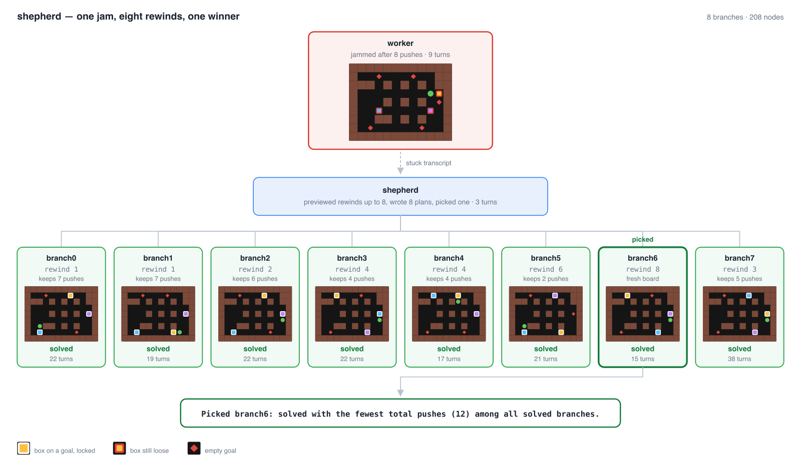

| Branch           |   Pushes undone | Outcome                | Turns |
| ---------------- | --------------: | ---------------------- | ----: |
| branch6 (picked) | 8 (fresh board) | solved, 12 pushes      |    15 |
| branch4          |               4 | solved, 15 pushes      |    17 |
| branch1          |               1 | solved, 17 pushes      |    19 |
| branch5          |               6 | solved, 19 pushes      |    21 |
| branch0, 2, 3    |         1, 2, 4 | solved, 20 pushes each |    22 |
| branch7          |               3 | solved, 36 pushes      |    38 |

Every branch solved the puzzle, so the pick came down to push count, and the shepherd submitted "Picked branch6: solved with the fewest total pushes (12) among all solved branches." Push counts include the pushes a branch kept from the worker. A single retry from the jam point would have failed. The run took about 9 minutes and held 157 nodes across the worker, the shepherd and the eight forks.

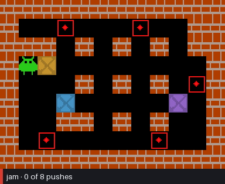

The animation plays the jam, undoes it push by push to the picked branch's depth, then replays that branch.

## Needle: harnesses mixed per agent

```bash
env -u ANTHROPIC_API_KEY python examples/needle/filesystem.py --all --no-viz \
  --out-dir examples/_runs/results/needle
```

100 files with one needle. The root splits the files into batches, launches a `searcher` agent per batch, and submits the number they find; the REPL root chose 10 batches and the Claude Code root 4. `--all` runs every combination of root harness and worker harness. One run of each (November 2026):

| Root              | Workers           | Correct | Agents | Seconds | Input tokens | Output tokens |
| ----------------- | ----------------- | ------- | -----: | ------: | -----------: | ------------: |
| REPL (gpt-5-mini) | REPL (gpt-5-nano) | yes     |     11 |      77 |          42k |           34k |
| REPL              | Claude Code       | yes     |     11 |      41 |         661k |            8k |
| Claude Code       | REPL              | yes     |      5 |      33 |         170k |           13k |
| Claude Code       | Claude Code       | yes     |      5 |      21 |         400k |            3k |

Claude Code root, Claude Code searchers:

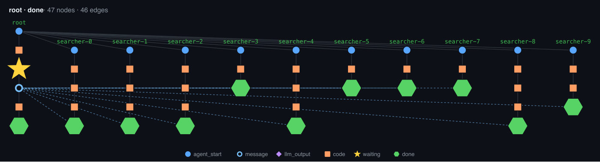

REPL root, REPL searchers:

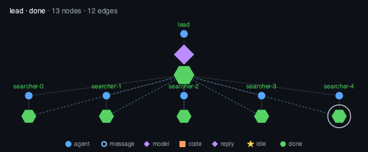

The graph has the same shape whichever harness runs which agent: the dashed lines are results coming back to the root. Claude Code sessions use many more input tokens because each turn carries Claude Code's own system prompt and tool output. The pi combinations were skipped because `pi` is not installed here.

## Autoresearch: planner plus GPU jobs

```bash
python examples/autoresearch/run.py --max-submissions 8 --parallel 4 \
  --planner repl --implementer repl                                             # REPL implementers
python examples/autoresearch/run.py --max-submissions 8 --parallel 4 \
  --planner repl                                                                # Claude Code implementers
```

A gpt-5 planner proposes changes to a small GPT trained on TinyStories. Each trial is implemented by a child agent and trained for 5 minutes on a Modal L4. The score is validation bits per byte (lower is better). These two runs are from Oct 30; they spend real GPU time, and nothing they use changed since.

**REPL implementers** (8 trials, 161k input / 60k output tokens): baseline 1.155 → **0.920** with a 2× learning rate. Dropout 0 also beat the baseline (1.001).

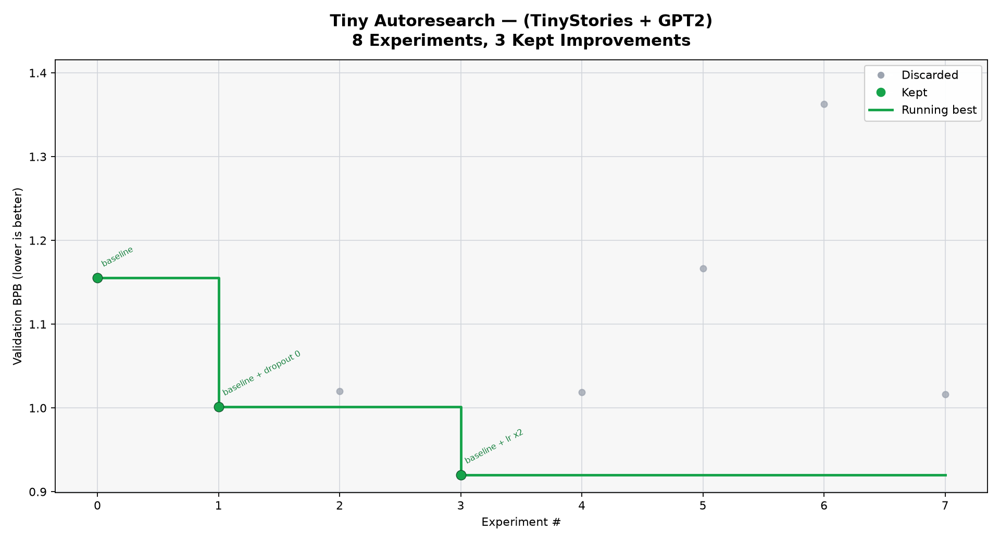

**Claude Code implementers** (8 trials, about $1.25 of Claude Code usage): baseline 1.155 → **0.866** with a 3× learning rate. Claude Code also corrected two plans that didn't match the code. Weight decay was already 0.1, so it tested 0.3. There was no step constant, so it halved the batch size to double the steps (0.959).

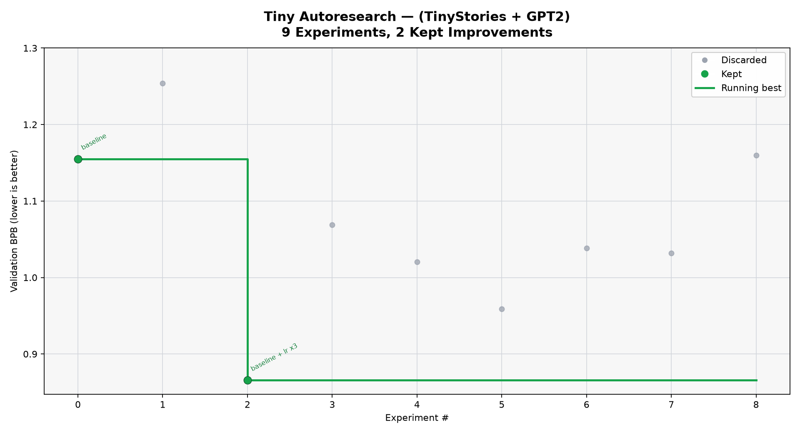

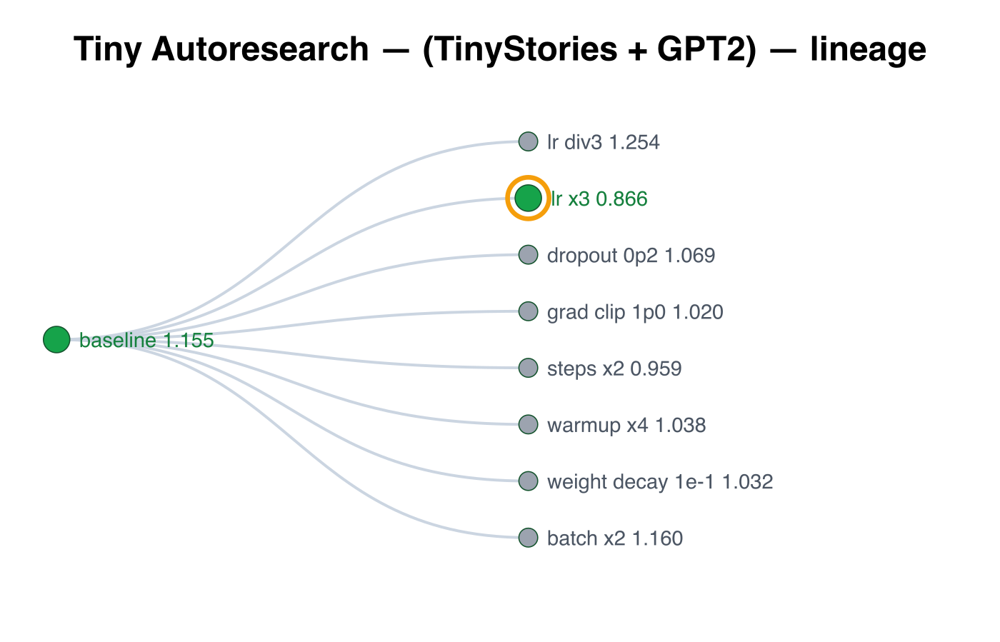

Both runs found the same lesson: the baseline is under-trained, and a larger learning rate is worth about 0.2–0.3 bpb. An earlier Claude Code run (0.837, 6 of 8 trials finished) hit a Modal startup race when trials launched concurrently. That is fixed with a lock in `modal_runner.py`, and it didn't recur.

## Peers: `send_agent`

```bash
python examples/patterns/peers.py --model gpt-5-mini
```

Three top-level agents with no manager. Alice asks bob and carol for their numbers with `await asyncio.gather(send_agent("bob", ...), send_agent("carol", ...))`, adds them, and sends the total back without waiting. Result: alice submitted 6 (correct), and bob and carol each answered "knows the total is 6". 21 nodes, 6k tokens.

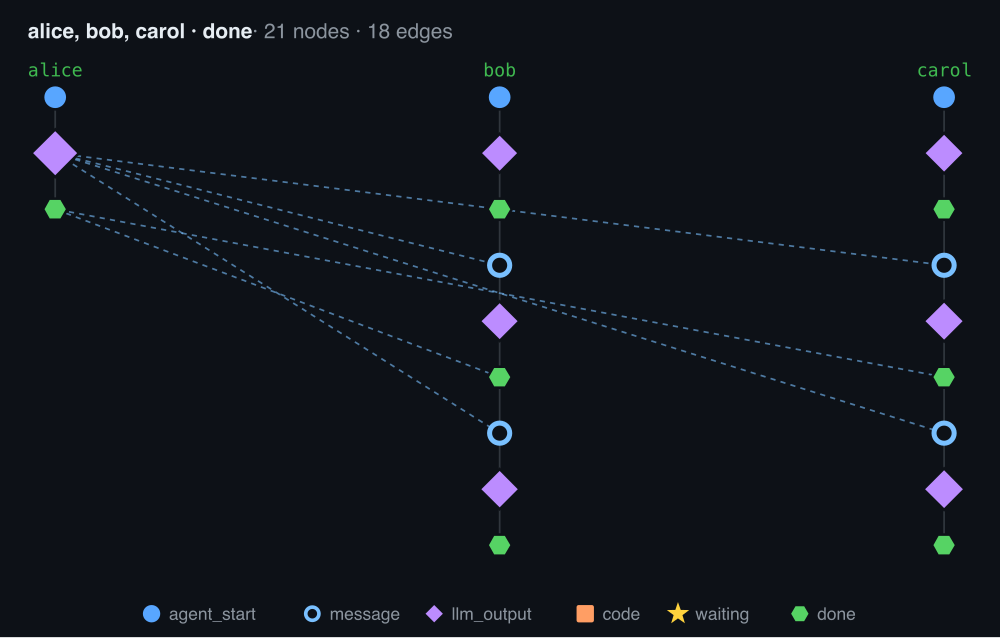

## Boids: peers on a shared task board

```bash
python examples/coding/boids/boids.py --harness claude_code --out-dir examples/_runs/coding/boids-board
```

The same spec and three Claude Code peers, now coordinating on a `TaskBoard` (Nov 20 2026). The prompt has one peer plan: each posts and claims a `plan` task before posting anything else, and whoever loses waits for `plan` to finish. The spec asks for a calm look: the canvas cleared every frame with no trails, glow or flashing, a slate background, and four muted colors of similar brightness.

`peer2` posted and claimed `plan` first (writes 1 and 2). `peer1`'s post and claim of `plan` came back `ok: False` (3 and 4), and so did `peer3`'s post (5); both then polled the board until `plan` was done. `peer2` published the interface (`window.BOIDS`; `config.js`, `grid.js`, `sim.js`, `render.js`, `main.js`, the page and the stylesheet), posted seven file tasks, finished `plan` (write 14), and claimed the simulation, the config and the page. `peer3` claimed the grid and the renderer (18 and 19) just before `peer1` asked for the same two (20 and 21, `ok: False`), so `peer1` took the loop and the stylesheet. 30 board writes, no direct messages, 3.3 minutes, 1.65M input and 35k output tokens ($1.60). The app loads with no console errors and passes every validation check; headless Chrome on this machine caps it at 30 FPS, which is the recording's readout.

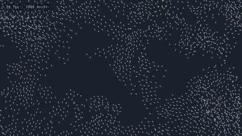

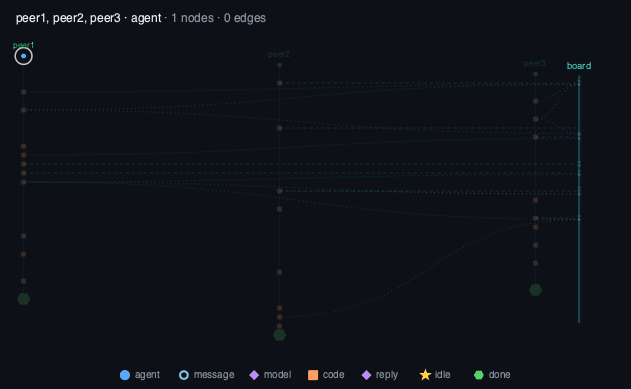

**The run with trails** (`examples/_runs/coding/boids-board-trails`). The same board and `plan` rule, with the earlier spec's fading trails and bright species. `peer1` won `plan`, `peer2` and `peer3` waited for it, and `peer3` lost two claims to `peer2`; 32 board writes, 3 direct messages about the page's key hint, 3.6 minutes ($2.84).

**The run before the `plan` task** (`examples/_runs/coding/boids-board-collision`). `peer3` published an interface (`window.Boids`, `js/config.js`, `grid.js`, `sim.js`, `render.js`, `main.js`) and posted one task per file; at the same time `peer1` published and posted its own plan. `peer1` read the board, published "IGNORE peer1 interface… peer3's interface (window.Boids, js/*.js) is canonical", finished its five tasks as "superseded by peer3 js/* tasks; no file written", and claimed `config.js`, `main.js` and the page. `peer3` took the grid and simulation, `peer2` the renderer, then posted and finished a `verify` task. 39 board writes, no direct messages, 2.8 minutes, 1.77M input and 37k output tokens ($2.09). The app ran with 2,000 boids and no console errors, and passed every validation check. Both peers had read an empty board before either wrote, which is the race the `plan` task closes. Validation after that run hit a headless-Chrome screenshot timeout in validation; it passes on a rerun, and the validator now records a timeout as a failed check.

## Boids: peers building components by messaging

```bash
python examples/coding/boids/boids.py --harness claude_code --out-dir examples/_runs/results/boids-v5-claude
python examples/coding/boids/render_simulation.py --run-dir examples/_runs/results/boids-v5-claude \
  --gif examples/_runs/results/boids-v5-claude/boids.gif --mp4 examples/_runs/results/boids-v5-claude/boids.mp4
```

Three top-level agents (`peer1`, `peer2`, `peer3`) with no manager share one directory. Each gets the same product spec (2000 boids, spatial partitioning, four species, trails, oriented shapes, an FPS readout) plus one line: there are three of you and no manager, so split the work, agree on interfaces by messaging each other, and write only the files you took on. Nothing names files, interfaces or numeric targets.

Their tools are generic: the file tools, their own REPL (Python, so they can run node themselves), and `open_page`, which loads a page in headless Chrome and returns its console output with no pass/fail. Grading happens after the run and the agents never see it: the page must load with no console errors, and the recording shows how it moves.

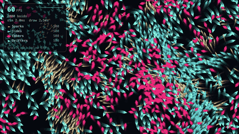

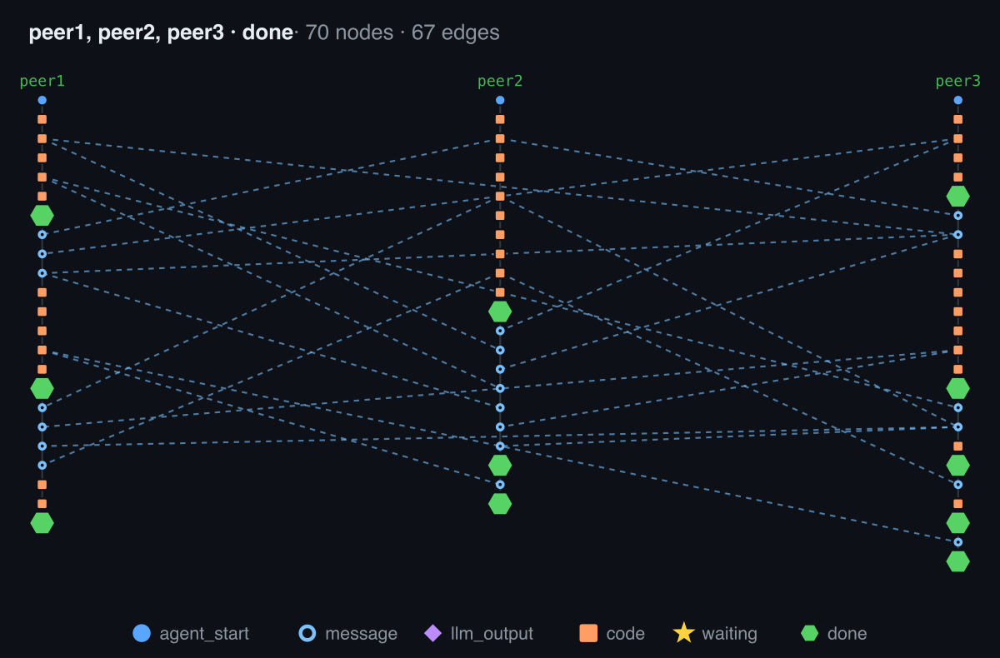

In the Claude Code run above, all three peers proposed a split at once. They converged on peer1's, which peer1 wrote into `INTERFACE.md`, then adapted to each other's constructor signatures. Each reported its timings and per-species speeds (151, 113, 75 and 126 px/s). The 21 messages are the dashed lines in the graph. The peers added extras nobody asked for: mouse attract and repel, pause, trail and glow toggles, and a legend.

| Run                                        |       Messages | App                                              | Minutes | Input / output tokens |
| ------------------------------------------ | -------------: | ------------------------------------------------ | ------: | --------------------- |
| gpt-5, run 1                               |             24 | works: four species move, triangles oversized    |    10.4 | 301k / 62k            |
| gpt-5, run 2                               |              7 | broken: all boids collapse into one blob         |     5.4 | 146k / 54k            |
| gpt-5, run 3                               |             27 | broken: boids collapse into blobs at the corners |    12.9 | 492k / 78k            |
| Claude Code, before the harness fix        | 0 in the graph | works, but peer3 never took part                 |     2.8 | 1.0M / 20k            |
| Claude Code, after the harness fix (above) |             21 | works: flocking, legend, 60 fps                  |     3.5 | 2.3M / 43k            |
| gpt-5 with screenshots, run 1              |             46 | works: four species flocking, 60 fps             |    10.5 | 562k / 75k            |
| gpt-5 with screenshots, run 2              |             13 | works: four species flocking, 60 fps             |     6.7 | 145k / 43k            |
| gpt-5 with screenshots, run 3              |             10 | flocks, but every boid renders grey              |     4.4 | 54k / 40k             |

All five loaded with no console errors, so load-only validation can't tell the good runs from the broken ones. These verdicts come from watching the recordings. Mid-run frames from the first four:

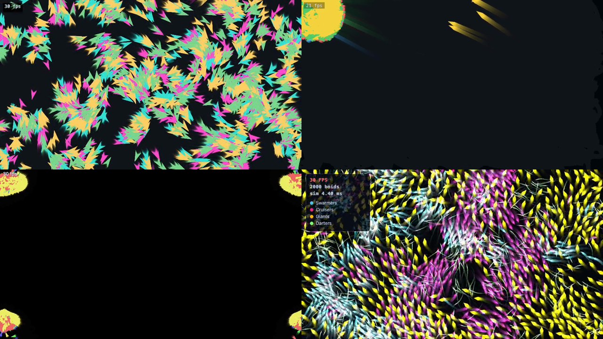

**Why the first gpt-5 runs broke.** The two broken apps had physics bugs in gpt-5's own code. Run 2's cohesion averaged `position × affinity` with negative affinities, so it pulled every boid toward (0, 0). In both runs, separation was about 100× weaker than cohesion. Patching only those lines makes both flock. No agent noticed, because none of them ran the simulation or looked at it; `open_page` only returned console output. The Claude Code peers wrote probe pages and ran node themselves.

**The rerun with screenshots.** The REPL harness can now show images to the model: a host tool calls `attach_image(path)`, and the image goes out with that node's output (`rlmflow/graph/nodes.py`, `rlmflow/harnesses/repl.py`). `open_page` now also shows the agent evenly spaced screenshots of the page. On three new gpt-5 runs all three apps flock. The tool isn't why: 4 of the 9 agents opened the page, and none in run 3. Run 3's renderer draws with additive blending (`globalCompositeOperation = 'lighter'`), so 2000 overlapping boids add up to near-white, which a single screenshot would have shown. The difference from the first round is mostly variance in the physics gpt-5 writes, and gpt-5 still treats "loads without errors" as done.

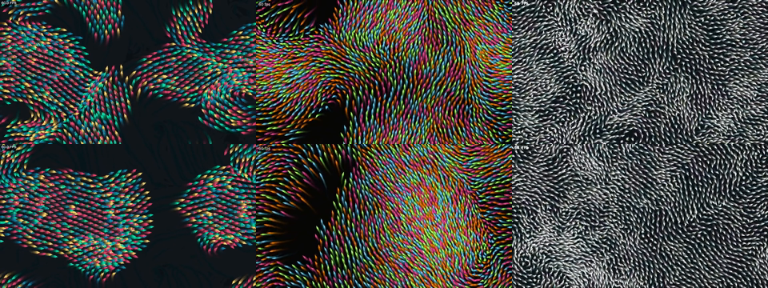

**Harness bug found here.** Claude Code has its own `SendMessage` and `ListAgents` tools for messaging other sessions on the same machine. The first Claude Code peers used those instead of `send_agent`, so none of their coordination was in the graph. peer3 sent its proposal outside rlmflow and ended its turn, and since rlmflow had no message to wake it with, it never came back. The Claude Code harness now disallows those two tools (`rlmflow/harnesses/claude_code.py`), so messages go through `send_agent`.

Two more Claude Code runs after the fix are excluded: my launch command ran each of them twice into the same directory, and the second copy wiped the first's files mid-run.

**Earlier versions of this example were rigged.** One version gave the agents the file split, the exact interface and numeric speed and alignment targets, and a `check_app()` that graded those targets. Its 4 of 4 showed only that the agents could follow instructions, so it was removed. Before that, a single agent wrote the whole app and passed 1 of 3 load-only checks.

## Gaps

- pi was not run; it isn't installed on this machine.
- Shepherd and Needle results are single runs; Shepherd's branch outcomes will vary run to run.
- Boids is graded by watching the recording; there is no automatic check for motion. Only one clean Claude Code run exists after the harness fix, and Claude has not been run in the REPL harness, so model and harness are still confounded.
- Autoresearch was not rerun today.
