# Example results

Real runs of the flagship examples, Nov 2 2026, on this machine. Run outputs (graphs, logs, traces) are in `examples/_runs/results/` and `examples/_runs/release-check/` (git-ignored); the figures below are copied into `docs/static/results/`.

| Example | Shows | Harnesses | Result |
| --- | --- | --- | --- |
| Shepherd (Sokoban) | Rewind, fork, parallel recovery | REPL, gpt-5 + gpt-5-mini | Worker jammed. 3 of 8 forked branches solved; picked one in 9 pushes |
| Needle | Recursive fan-out; harnesses mixed per agent | REPL and Claude Code, root × workers | 4 of 4 combinations correct |
| Autoresearch | Planner plus long-running GPU jobs | REPL planner; REPL or Claude Code implementers | val_bpb 1.155 → 0.920 (REPL), → 0.866 (Claude Code) |
| Peers | Agents messaging each other with `send_agent` | REPL, gpt-5-mini | Correct total (6); both peers acknowledged it |
| Boids | Peers with no manager split the work and agree on interfaces by message | REPL (gpt-5) or Claude Code | Claude Code: a working app with 21 messages in the graph. gpt-5: 1 of 3 worked, then 3 of 3 flocked on a rerun (one renders all grey) |

## Shepherd: rewind and fork

```bash
python examples/shepherd/shepherd.py --trace --out-dir examples/_runs/results/shepherd
python examples/shepherd/render_rewind.py --run-dir examples/_runs/results/shepherd
python examples/shepherd/render_graph.py --run-dir examples/_runs/results/shepherd
```

A worker plays Sokoban and jams a box against a wall after 8 pushes. The shepherd reads the stuck transcript, previews the board at each rewind depth, and forks 8 branches from 8 different points in the worker's run, each with its own plan.

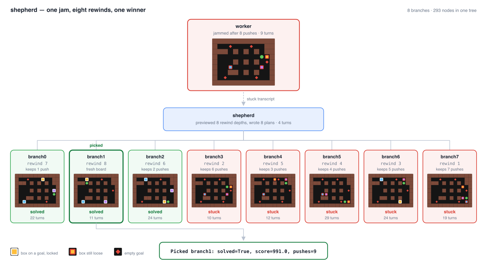

| Branch | Pushes undone | Outcome | Turns |
| --- | ---: | --- | ---: |
| branch1 (picked) | 8 (fresh board) | solved, 9 pushes | 11 |
| branch0 | 7 | solved | 22 |
| branch2 | 6 | solved | 24 |
| branch3–7 | 1–5 | stuck | 10–29 |

The rewind depth is what decided the outcome. Every branch that undid 6 or more pushes solved the puzzle; every branch that kept 3 or more of the jammed pushes stayed stuck. A single retry from the jam point would have failed. The run took about 8 minutes, 293 nodes and 288k input / 101k output tokens.

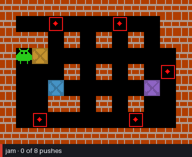

The animation plays the jam, undoes it push by push to the chosen depth, then replays the winning branch.

## Needle: harnesses mixed per agent

```bash
env -u ANTHROPIC_API_KEY python examples/needle/filesystem.py --all --no-viz \
  --out-dir examples/_runs/results/needle
```

100 files with one needle. The root splits the files into batches, launches a `searcher` agent per batch, and submits the number they find; the REPL root chose 10 batches and the Claude Code root 4. `--all` runs every combination of root harness and worker harness. One run of each (November 2026):

| Root | Workers | Correct | Agents | Seconds | Input tokens | Output tokens |
| --- | --- | --- | ---: | ---: | ---: | ---: |
| REPL (gpt-5-mini) | REPL (gpt-5-nano) | yes | 11 | 77 | 42k | 34k |
| REPL | Claude Code | yes | 11 | 41 | 661k | 8k |
| Claude Code | REPL | yes | 5 | 33 | 170k | 13k |
| Claude Code | Claude Code | yes | 5 | 21 | 400k | 3k |

Claude Code root, Claude Code searchers:

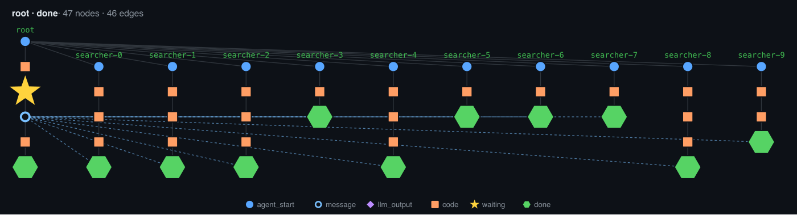

REPL root, REPL searchers:

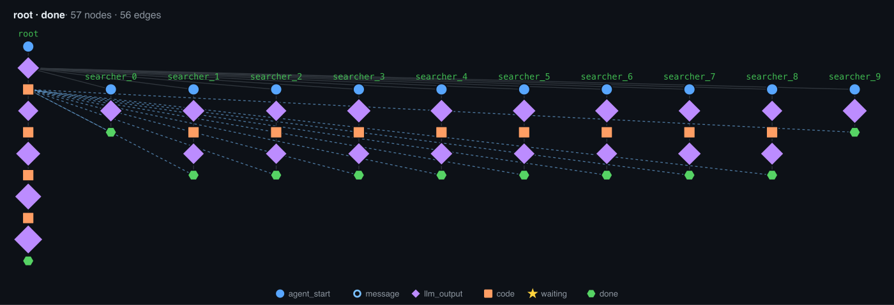

The graph has the same shape whichever harness runs which agent: the dashed lines are results coming back to the root. Claude Code sessions use many more input tokens because each turn carries Claude Code's own system prompt and tool output. The pi combinations were skipped because `pi` is not installed here.

## Autoresearch: planner plus GPU jobs

```bash
python examples/autoresearch/run.py --max-submissions 8 --parallel 4            # REPL implementers
python examples/autoresearch/run.py --max-submissions 8 --parallel 4 \
  --implementer-harness claude_code                                             # Claude Code implementers
```

A gpt-5 planner proposes changes to a small GPT trained on TinyStories. Each trial is implemented by a child agent and trained for 5 minutes on a Modal L4. The score is validation bits per byte (lower is better). These two runs are from Oct 30; they spend real GPU time, and nothing they use changed since.

**REPL implementers** (8 trials, 161k input / 60k output tokens): baseline 1.155 → **0.920** with a 2× learning rate. Dropout 0 also beat the baseline (1.001).

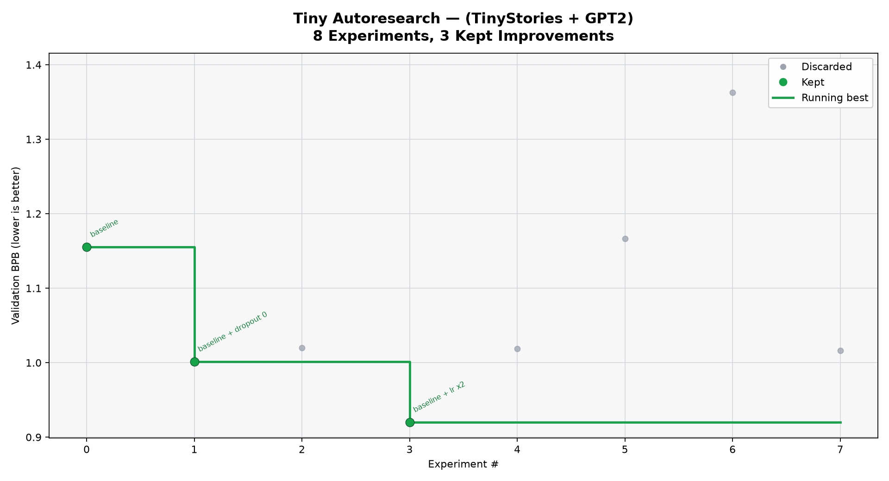

**Claude Code implementers** (8 trials, about $1.25 of Claude Code usage): baseline 1.155 → **0.866** with a 3× learning rate. Claude Code also corrected two plans that didn't match the code. Weight decay was already 0.1, so it tested 0.3. There was no step constant, so it halved the batch size to double the steps (0.959).

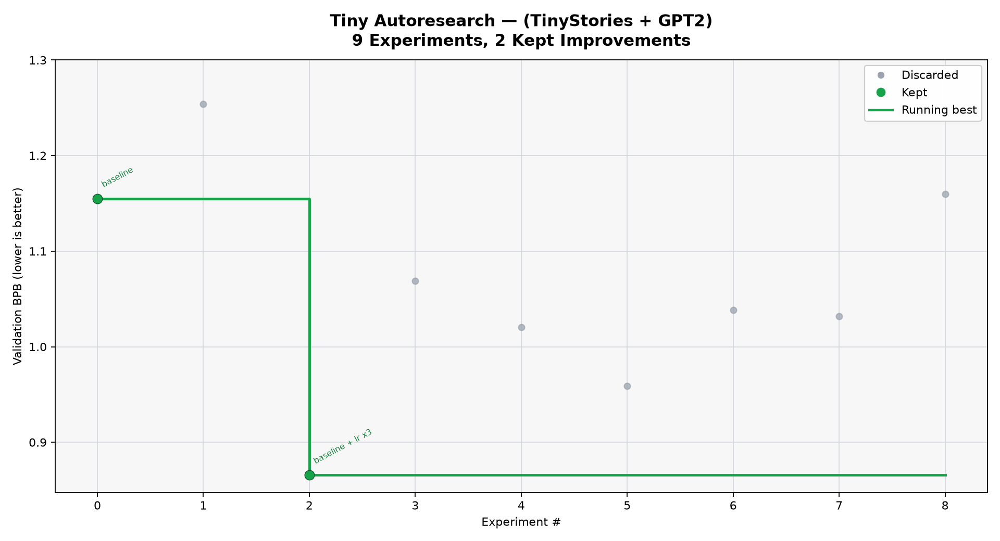

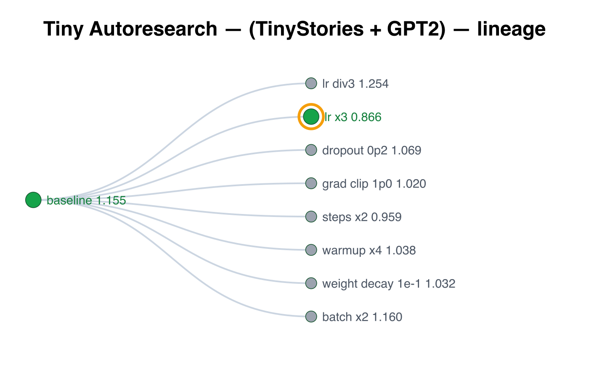

Both runs found the same lesson: the baseline is under-trained, and a larger learning rate is worth about 0.2–0.3 bpb. An earlier Claude Code run (0.837, 6 of 8 trials finished) hit a Modal startup race when trials launched concurrently. That is fixed with a lock in `modal_runner.py`, and it didn't recur.

## Peers: `send_agent`

```bash
python examples/collaboration/decentralized_peers.py --model gpt-5-mini
```

Three top-level agents with no manager. Alice asks bob and carol for their numbers with `await asyncio.gather(send_agent("bob", ...), send_agent("carol", ...))`, adds them, and sends the total back without waiting. Result: alice submitted 6 (correct), and bob and carol each answered "knows the total is 6". 21 nodes, 6k tokens.

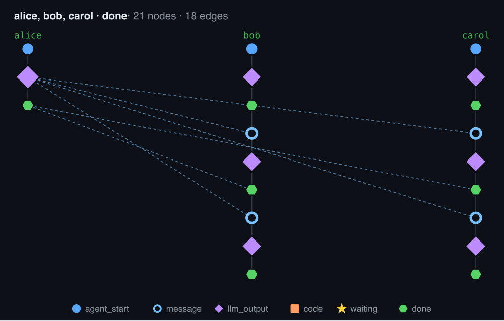

## Boids: peers building components

```bash
python examples/coding/boids/boids.py --harness claude_code --out-dir examples/_runs/results/boids-v5-claude
python examples/coding/boids/render_simulation.py --run-dir examples/_runs/results/boids-v5-claude \
  --gif examples/_runs/results/boids-v5-claude/boids.gif --mp4 examples/_runs/results/boids-v5-claude/boids.mp4
```

Three top-level agents (`peer1`, `peer2`, `peer3`) with no manager share one directory. Each gets the same product spec (2000 boids, spatial partitioning, four species, trails, oriented shapes, an FPS readout) plus one line: there are three of you and no manager, so split the work, agree on interfaces by messaging each other, and write only the files you took on. Nothing names files, interfaces or numeric targets.

Their tools are generic: the file tools, their own REPL (Python, so they can run node themselves), and `open_page`, which loads a page in headless Chrome and returns its console output with no pass/fail. Grading happens after the run and the agents never see it: the page must load with no console errors, and the recording shows how it moves.

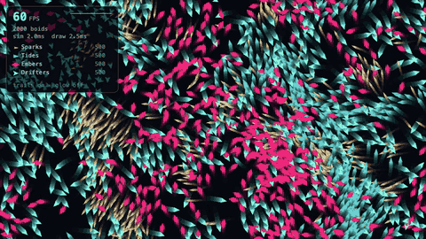

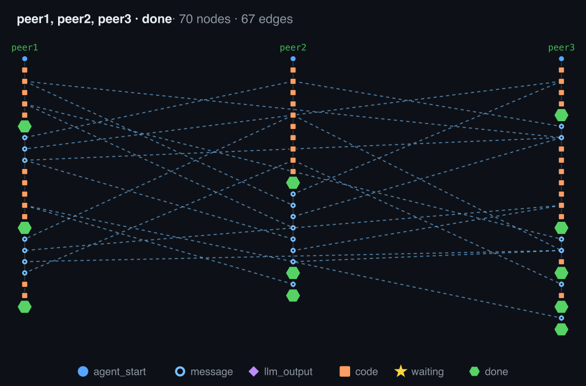

In the Claude Code run above, all three peers proposed a split at once. They converged on peer1's, which peer1 wrote into `INTERFACE.md`, then adapted to each other's constructor signatures. Each reported its timings and per-species speeds (151, 113, 75 and 126 px/s). The 21 messages are the dashed lines in the graph. The peers added extras nobody asked for: mouse attract and repel, pause, trail and glow toggles, and a legend.

| Run | Messages | App | Minutes | Input / output tokens |
| --- | ---: | --- | ---: | --- |
| gpt-5, run 1 | 24 | works: four species move, triangles oversized | 10.4 | 301k / 62k |
| gpt-5, run 2 | 7 | broken: all boids collapse into one blob | 5.4 | 146k / 54k |
| gpt-5, run 3 | 27 | broken: boids collapse into blobs at the corners | 12.9 | 492k / 78k |
| Claude Code, before the harness fix | 0 in the graph | works, but peer3 never took part | 2.8 | 1.0M / 20k |
| Claude Code, after the harness fix (above) | 21 | works: flocking, legend, 60 fps | 3.5 | 2.3M / 43k |
| gpt-5 with screenshots, run 1 | 46 | works: four species flocking, 60 fps | 10.5 | 562k / 75k |
| gpt-5 with screenshots, run 2 | 13 | works: four species flocking, 60 fps | 6.7 | 145k / 43k |
| gpt-5 with screenshots, run 3 | 10 | flocks, but every boid renders grey | 4.4 | 54k / 40k |

All five loaded with no console errors, so load-only validation can't tell the good runs from the broken ones. These verdicts come from watching the recordings. Mid-run frames from the first four:

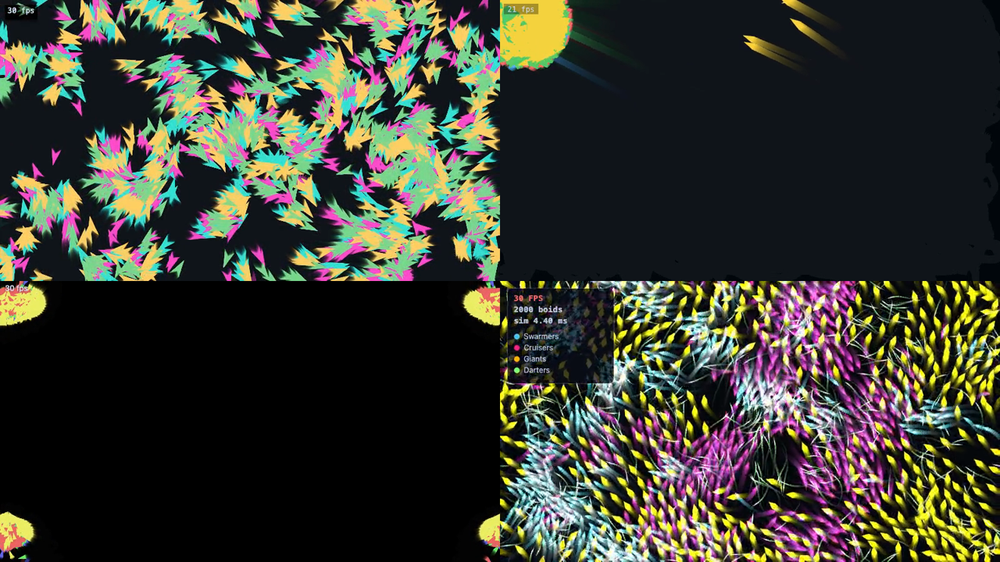

**Why the first gpt-5 runs broke.** The two broken apps had physics bugs in gpt-5's own code. Run 2's cohesion averaged `position × affinity` with negative affinities, so it pulled every boid toward (0, 0). In both runs, separation was about 100× weaker than cohesion. Patching only those lines makes both flock. No agent noticed, because none of them ran the simulation or looked at it; `open_page` only returned console output. The Claude Code peers wrote probe pages and ran node themselves.

**The rerun with screenshots.** The REPL harness can now show images to the model: a host tool calls `attach_image(path)`, and the image goes out with that node's output (`rlmflow/graph/nodes.py`, `rlmflow/harnesses/repl.py`). `open_page` now also shows the agent evenly spaced screenshots of the page. On three new gpt-5 runs all three apps flock. The tool isn't why: 4 of the 9 agents opened the page, and none in run 3. Run 3's renderer draws with additive blending (`globalCompositeOperation = 'lighter'`), so 2000 overlapping boids add up to near-white, which a single screenshot would have shown. The difference from the first round is mostly variance in the physics gpt-5 writes, and gpt-5 still treats "loads without errors" as done.

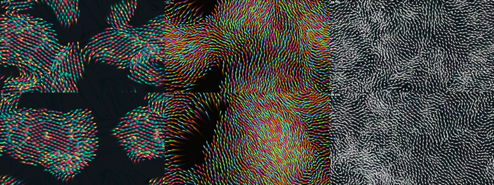

**Harness bug found here.** Claude Code has its own `SendMessage` and `ListAgents` tools for messaging other sessions on the same machine. The first Claude Code peers used those instead of `send_agent`, so none of their coordination was in the graph. peer3 sent its proposal outside rlmflow and ended its turn, and since rlmflow had no message to wake it with, it never came back. The Claude Code harness now disallows those two tools (`rlmflow/harnesses/claude_code.py`), so messages go through `send_agent`.

Two more Claude Code runs after the fix are excluded: my launch command ran each of them twice into the same directory, and the second copy wiped the first's files mid-run.

**Earlier versions of this example were rigged.** One version gave the agents the file split, the exact interface and numeric speed and alignment targets, and a `check_app()` that graded those targets. Its 4 of 4 showed only that the agents could follow instructions, so it was removed. Before that, a single agent wrote the whole app and passed 1 of 3 load-only checks.

## Gaps

- pi was not run; it isn't installed on this machine.
- Shepherd and Needle results are single runs; Shepherd's branch outcomes will vary run to run.
- Boids is graded by watching the recording; there is no automatic check for motion. Only one clean Claude Code run exists after the harness fix, and Claude has not been run in the REPL harness, so model and harness are still confounded.
- Autoresearch was not rerun today.
